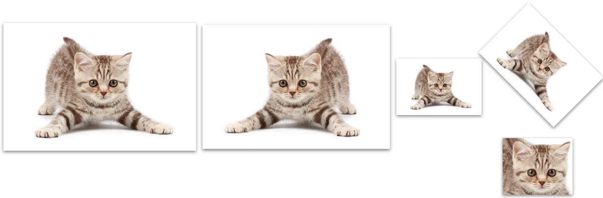
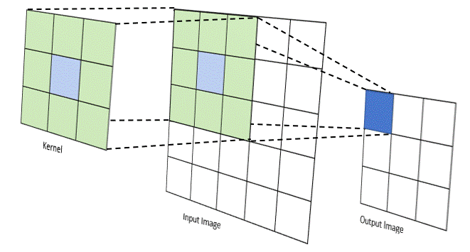
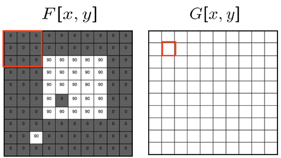
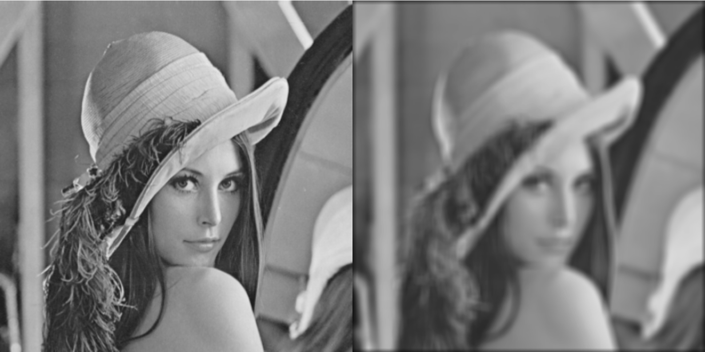
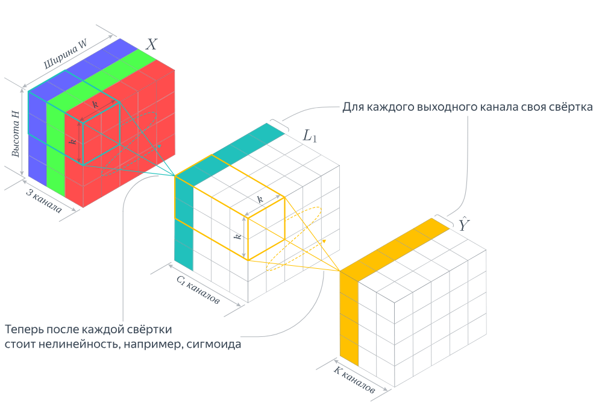
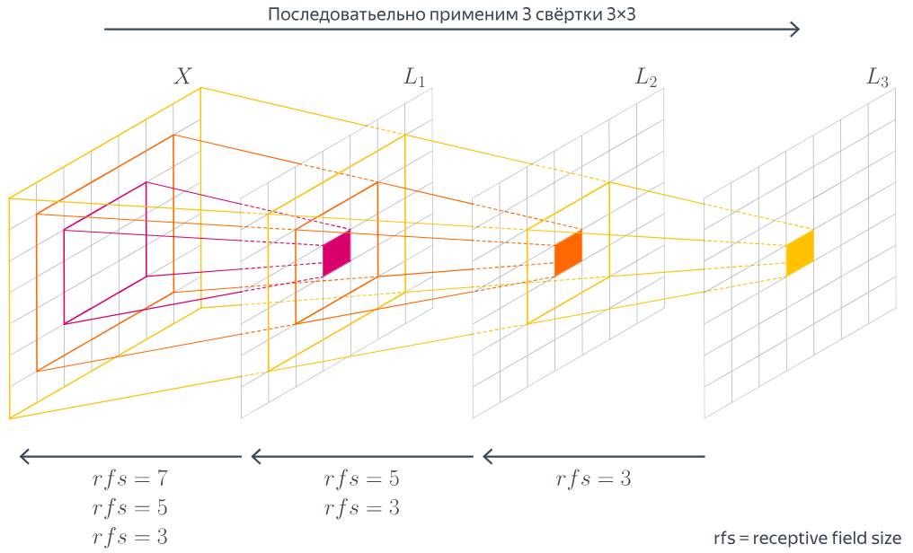
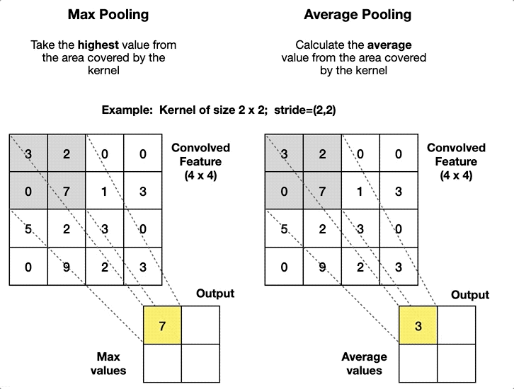
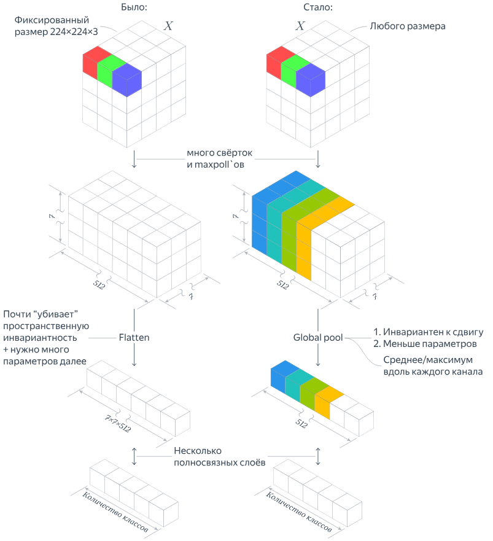
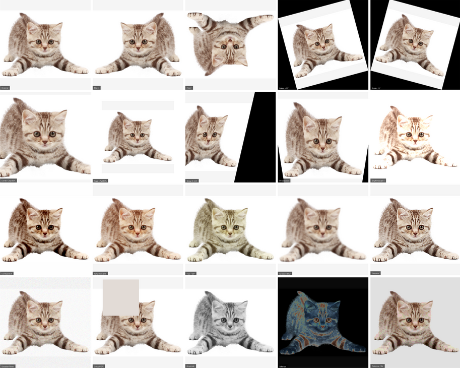

## О чём эта глава

На предыдущей лекции мы познакомились с многослойным персептроном (MLP). Теперь попробуем применить нейронные сети к изображениям. Сначала разберёмся, как компьютер представляет изображение, затем выясним, почему простого MLP часто недостаточно, и познакомимся со свёрточными сетями (CNN). В конце рассмотрим три основные задачи компьютерного зрения: классификацию, детекцию и сегментацию.

**После изучения главы** вы сможете:

- объяснить, чем изображение как тензор отличается от обычного вектора признаков;
- вычислить форму выхода и число параметров свёрточного слоя;
- объяснить назначение `stride`, `padding`, `dilation`, пулинга и Global Average Pooling;
- собрать небольшую CNN в PyTorch и выполнить один шаг обучения;
- различать постановки задач классификации, детекции и сегментации и выбирать базовые метрики для них.

В машинном обучении слово *домен* используется в нескольких значениях. Например, в задачах переноса знаний оно может обозначать распределение данных. Чтобы избежать неоднозначности, здесь будем говорить **о модальности данных — изображениях — и о задачах компьютерного зрения**. Компьютерное зрение изучает методы извлечения информации из изображений и видео; обработка изображений является важной, но не единственной его частью.

## Цифровое изображение как тензор

**Растровое изображение** — прямоугольная сетка пикселей. В каждой позиции хранятся значения одного или нескольких каналов: например, один канал яркости в полутоновом изображении или три цветовых канала RGB.

Цветное RGB-изображение высоты $H$ и ширины $W$ удобно представить тензором

$$
X\in\mathbb{R}^{3\times H\times W}.
$$

В PyTorch соглашение обычно такое: **`(C, H, W)`** для одного изображения и **`(N, C, H, W)`** для пакета (*batch*) из $N$ изображений. Здесь $C$ — число каналов. У полутонового изображения $C=1$; у RGB-изображения $C=3$; бывают и другие варианты, включая многоспектральные данные.

Изображения часто хранятся как целые числа от 0 до 255, а перед передачей в нейросеть преобразуются в числа с плавающей точкой, например в диапазоне $[0,1]$, и при необходимости нормализуются.

> [!EXAMPLE] Посмотрим на размеры тензоров
> ```python
> import torch
>
> image = torch.rand(3, 32, 32)    # одно RGB-изображение
> batch = torch.rand(8, 3, 32, 32)  # пакет из 8 изображений
> print(image.shape)  # torch.Size([3, 32, 32])
> print(batch.shape)  # torch.Size([8, 3, 32, 32])
> ```
>
> **Вопрос:** как изменятся размеры тензоров, если изображения будут полутоновыми?

## Почему не ограничиться многослойным персептроном?

MLP принимает вектор. Изображение можно развернуть в вектор (*flatten*), но такая операция не сообщает сети, какие пиксели были соседями. MLP в принципе может выучить пространственные закономерности, однако для этого ему зачастую требуется много параметров и данных.

Представим RGB-изображение $32\times32$: после разворачивания получится $3\cdot32\cdot32=3072$ входных чисел. Если полносвязным преобразованием мы хотим получить 16 карт признаков того же пространственного размера, выход будет содержать $16\cdot32\cdot32=16384$ чисел. Для такого слоя потребуется

$$
3072\cdot16384+16384=50\,348\,032
$$

обучаемых параметра с учётом смещений. Это не единственная и не обязательная архитектура MLP, но пример хорошо показывает цену **независимых весов для разных пространственных позиций**.

У свёрточного слоя иная идея: небольшой набор весов применяется ко всем участкам изображения. Это называют **разделением параметров** (*weight sharing*). Такая операция помогает находить похожие локальные признаки в разных местах изображения.



> [!NOTE] Важное различие
> Свёртка обладает свойством **эквивариантности к сдвигу** (приближённо, с оговорками о границах изображения, шаге и других операциях): при сдвиге входа сдвигается и карта признаков. Это **не то же самое**, что инвариантность классификации, когда ответ остаётся неизменным при сдвиге объекта. К инвариантности сеть может приблизиться благодаря архитектуре, обучающим данным и аугментациям.

## От фильтра изображения к свёртке

### Локальный фильтр

Пусть полутоновое изображение задано функцией $X(i,j)$, которая сопоставляет координатам пикселя его яркость. Простейшее преобразование может изменять каждый пиксель независимо. Например, инверсия яркости $Y(i,j)=1-X(i,j)$ для значений в $[0,1]$.

Но для размытия или поиска границ одного пикселя недостаточно: нужно посмотреть **на его соседей**. Эту идею реализует локальная фильтрация с помощью небольшого ядра $K$. Для иллюстрации рассмотрим двумерную **взаимную корреляцию**:

$$
Y(i,j)=\sum_{u=0}^{k_h-1}\sum_{v=0}^{k_w-1}K(u,v)X(i+u,j+v).
$$

Здесь мы временно опустили индексы каналов и обработку краёв изображения. Ядро последовательно перемещается по изображению; в каждом положении вычисляется взвешенная сумма значений окна.

В строгом математическом определении **свёртки** ядро предварительно отражается по обеим осям. Большинство свёрточных слоёв современных DL-библиотек, в том числе `torch.nn.Conv2d`, фактически вычисляют взаимную корреляцию. В практике глубокого обучения обе операции обычно называют «свёрткой»: поскольку веса обучаются, различие в ориентации ядра не ограничивает выразительность слоя.



### Пример: поиск вертикальной границы

Рассмотрим изображение из нулей слева и единиц справа. Ядро Собеля реагирует на перепады яркости по горизонтальному направлению (то есть выделяет преимущественно **вертикальные границы**):

$$
K_x=\begin{pmatrix}
-1&0&1\\
-2&0&2\\
-1&0&1
\end{pmatrix}.
$$

```python
import torch
import torch.nn.functional as F

# Светлая правая половина на тёмном фоне.
image = torch.zeros(1, 1, 8, 8)  # N, C, H, W
image[:, :, :, 4:] = 1.0

sobel_x = torch.tensor([
    [-1., 0., 1.],
    [-2., 0., 2.],
    [-1., 0., 1.],
]).reshape(1, 1, 3, 3)  # C_out, C_in, kH, kW

edges = F.conv2d(image, sobel_x, padding=1)
print(edges[0, 0, 3].tolist())
# [0.0, 0.0, 0.0, 4.0, 4.0, 0.0, 0.0, -4.0]
```

На границе двух половин возникает сильный отклик. Отрицательное значение у правого края связано с нулевым дополнением (`padding=1`): за пределами изображения алгоритм «видит» нули.

> [!QUESTION] Проверьте себя
> Что изменится, если поменять знак всех коэффициентов ядра? А если заменить ядро на матрицу, все девять элементов которой равны $1/9$?

Классические фильтры — например, усреднение, фильтр Гаусса или фильтр Собеля — используют **заданные заранее** коэффициенты. Изменяя их, мы получаем различные преобразования.





## Обучаемая свёртка в нейросети

Главная идея CNN: **не задавать ядра вручную, а обучать их значения вместе с остальными параметрами сети** с помощью градиентного спуска.

В обычном слое `Conv2d` каждый выходной канал вычисляется с использованием **всех входных каналов**. Для выходного канала $o$:

$$
Y_{o,i,j}=b_o+\sum_{c=1}^{C_{in}}\sum_{u=0}^{k_h-1}\sum_{v=0}^{k_w-1}
K_{o,c,u,v}\,X_{c,i+u,j+v}.
$$

Для простоты здесь не записаны шаг, дополнение и расширение ядра. Форма тензора весов в PyTorch — **`(C_out, C_in, kH, kW)`** (при `groups=1`). Количество обучаемых параметров равно

$$
N_\text{params}=C_{out}(C_{in}k_hk_w+1),
$$

если у слоя есть смещения (`bias=True`).



Карта признаков — это результат применения обученного фильтра по пространственным позициям. Разные каналы могут реагировать на разные локальные закономерности. После `Conv2d` обычно добавляют нелинейность, например `ReLU`, но **сам `Conv2d` не применяет функцию активации автоматически**.

### Практика: размеры и параметры

```python
import torch
from torch import nn

x = torch.randn(8, 3, 32, 32)
conv = nn.Conv2d(in_channels=3, out_channels=16,
                 kernel_size=3, stride=1, padding=1)
y = conv(x)

print(y.shape)  # torch.Size([8, 16, 32, 32])
print(sum(p.numel() for p in conv.parameters()))  # 448
```

Итак, вместо более чем 50 миллионов параметров в приведённом выше пространственно-полносвязном примере — **448 параметров**: $16\cdot(3\cdot3\cdot3+1)$. Выходы имеют одинаковую форму `(8, 16, 32, 32)`, хотя способы вычисления принципиально отличаются.

### `stride`, `padding`, `dilation`

- **`kernel_size`** — пространственный размер ядра, например $3\times3$.
- **`stride`** — шаг перемещения ядра. При `stride=2` карта признаков обычно становится меньше.
- **`padding`** — дополнение границ изображения (по умолчанию нулями). При ядре $3\times3$, `stride=1`, `dilation=1` значение `padding=1` сохраняет высоту и ширину.
- **`dilation`** — расстояние между соседними используемыми элементами ядра. Это позволяет увеличить область охвата без увеличения числа коэффициентов.

Для квадратного ядра размера $k$ и одинаковых параметров по двум осям высота выхода равна

$$
H_{out}=\left\lfloor\frac{H_{in}+2p-d(k-1)-1}{s}+1\right\rfloor,
$$

аналогично вычисляется $W_{out}$. Параметры по высоте и ширине могут различаться.

> [!NOTE] Уточнение про `same`
> Термин *same* означает сохранение (или определённое правило расчёта) пространственного размера в зависимости от библиотеки и `stride`. В `torch.nn.Conv2d` значение `padding="same"` **не поддерживает `stride`, отличный от 1**. Поэтому для первого знакомства надёжнее разбирать численный `padding`.

Полезная интерактивная подборка иллюстраций: [Convolution arithmetic](https://github.com/vdumoulin/conv_arithmetic).

> [!QUESTION] Упражнение
> Измените в предыдущем примере `stride=1` на `stride=2`. Предскажите форму выхода **до запуска** кода. Затем установите `padding=0`. Почему результат изменился?

### Рецептивное поле

**Рецептивное поле** элемента карты признаков — область входного изображения, которая потенциально влияет на значение этого элемента. При двух последовательных слоях $3\times3$, с `stride=1` и `dilation=1`, теоретическое рецептивное поле увеличивается до $5\times5$, при трёх — до $7\times7$.



Здесь важно различать **теоретическое** рецептивное поле, определяемое архитектурой, и **эффективное** рецептивное поле: на практике разные входные пиксели могут влиять на выход с разной силой. Чтобы сеть учитывала действительно большой контекст, недостаточно произнести слово «глубокая»: это зависит от количества слоёв, их параметров и всей архитектуры.

## Пулинг и глобальное усреднение

### Уменьшение пространственного разрешения

**Pooling** уменьшает пространственный размер карты признаков, агрегируя значения внутри локальных окон. При `MaxPool2d(2)` берётся максимум из каждого непересекающегося окна $2\times2$; при `AvgPool2d(2)` — среднее значение.



Пулинг сам по себе обычно **не содержит обучаемых параметров** и **не уменьшает число каналов**. Его главная роль — сократить пространственное разрешение, вычислительные затраты следующих слоёв и чувствительность к некоторым небольшим локальным изменениям. Взамен часть информации теряется. Уменьшать разрешение можно и с помощью свёртки с шагом больше единицы.

### Global Average Pooling

После свёрточных слоёв для классификации нам нужно перейти от тензора `(N, C, H, W)` к признаковому вектору каждого изображения. Один из способов — **Global Average Pooling (GAP)**:

$$
z_{n,c}=\frac{1}{HW}\sum_{i=1}^{H}\sum_{j=1}^{W}X_{n,c,i,j}.
$$

Операция превращает `(N, C, H, W)` в `(N, C, 1, 1)`. В PyTorch для этого можно использовать `nn.AdaptiveAvgPool2d(1)`.



GAP позволяет отказаться от большого полносвязного слоя над всеми пространственными позициями и, если остальная сеть не требует фиксированного разрешения, обрабатывать разные размеры изображений. Но это **не гарантирует** инвариантности предсказания ко всем геометрическим преобразованиям.

### Практика: минимальная CNN

```python
import torch
from torch import nn

class MiniCNN(nn.Module):
    def __init__(self):
        super().__init__()
        self.features = nn.Sequential(
            nn.Conv2d(3, 16, kernel_size=3, padding=1),
            nn.ReLU(),
            nn.MaxPool2d(2),
            nn.Conv2d(16, 32, kernel_size=3, padding=1),
            nn.ReLU(),
        )
        self.pool = nn.AdaptiveAvgPool2d(1)
        self.head = nn.Linear(32, 10)

    def forward(self, x):
        x = self.features(x)      # (N, 32, 16, 16) для входа 32×32
        x = self.pool(x)          # (N, 32, 1, 1)
        x = x.flatten(start_dim=1)  # (N, 32)
        return self.head(x)       # (N, 10)

model = MiniCNN()
x = torch.randn(8, 3, 32, 32)
print(model(x).shape)  # torch.Size([8, 10])
```

Выход модели — **10 логитов**, по одному на каждый класс. Это не вероятности; для обучения многоклассовой классификации в PyTorch обычно используют `nn.CrossEntropyLoss`, которая работает непосредственно с логитами. Дополнительный `Softmax` перед ней не нужен.

## Как обучать модель на изображениях

До сих пор мы запускали свёрточный слой на искусственных данных. Для реального эксперимента нам потребуются размеченные изображения, обучающая функция потерь и независимая оценка качества. Например, часто используют учебный набор [CIFAR-10](https://www.cs.toronto.edu/~kriz/cifar.html): RGB-изображения $32\times32$ с десятью классами.

### Аугментации

**Аугментация** — преобразование обучающего примера, которое должно сохранять правильную метку для решаемой задачи. Например, для классификации многих природных объектов подходят отражение и небольшой случайный сдвиг; для распознавания цифр горизонтальное отражение может изменить смысл изображения. В задачах детекции и сегментации геометрические преобразования должны также корректно преобразовывать рамки или маски.



```python
from torchvision import transforms

train_transform = transforms.Compose([
    transforms.RandomCrop(32, padding=4),
    transforms.RandomHorizontalFlip(),
    transforms.ToTensor(),
])

eval_transform = transforms.ToTensor()
```

**Аугментации применяют к обучающей части данных.** Для валидации и тестирования используют детерминированную предобработку. При работе с реальным датасетом часто добавляют нормализацию с параметрами, рассчитанными **по обучающим данным**, а не по тестовым.

### Практика: один шаг обучения

Продолжим использовать `MiniCNN`, определённую выше. Для примера возьмём один пакет CIFAR-10; первый запуск загрузит датасет.

```python
import torch
from torch import nn
from torch.utils.data import DataLoader
from torchvision.datasets import CIFAR10

train_ds = CIFAR10(
    root="./data", train=True, download=True,
    transform=train_transform,
)
loader = DataLoader(train_ds, batch_size=32, shuffle=True)

images, labels = next(iter(loader))  # (32, 3, 32, 32), (32,)
criterion = nn.CrossEntropyLoss()
optimizer = torch.optim.Adam(model.parameters(), lr=1e-3)

model.train()
optimizer.zero_grad()
logits = model(images)          # (32, 10)
loss = criterion(logits, labels)
loss.backward()
optimizer.step()

print(f"Loss на первом шаге: {loss.item():.3f}")
```

Это **один шаг обучения, а не полноценный эксперимент**. Для получения модели нужно организовать эпохи обучения, отдельно отслеживать качество на валидации и один раз оценивать окончательную модель на тестовом наборе. Проводить выводы о качестве по одной функции потерь после шага нельзя.

> [!QUESTION] Мини-исследование
> Обучите `MiniCNN` на CIFAR-10 и сравните три варианта: (1) без аугментаций, (2) с аугментациями, (3) со свёрткой `stride=2` вместо `MaxPool2d`. Сохраняйте одинаковые разбиение данных и число эпох. Сравните обучающую и валидационную accuracy.

## Как устроены более глубокие CNN

Нашу `MiniCNN` легко понять, но для сложных задач используют сети с большим числом слоёв и особыми связями между блоками. Полезно изучать не только названия архитектур, а **инженерную идею**, ради которой каждая из них появилась.

### Эволюция архитектур для классификации

| Архитектура | Основная идея |
| --- | --- |
| **LeNet-5** | Ранний пример CNN для распознавания рукописных цифр |
| **AlexNet** | Показала эффективность глубоких CNN на ImageNet в 2012 году |
| **VGG** | Последовательное применение небольших ядер $3\times3$ |
| **GoogLeNet / Inception** | Параллельные преобразования с разными масштабами и объединение их результатов |
| **ResNet** | Остаточные связи: обучение поправки $F(x)$ и сложение её с входом |
| **DenseNet** | Объединение карт признаков из нескольких предшествующих слоёв для повторного использования признаков |

Основная идея **Inception** — несколько параллельных ветвей с различными пространственными масштабами и последующее объединение их выходов. Свёртки $1\times1$ также могут уменьшать число каналов и вычислительную нагрузку.

### ResNet: зачем нужна остаточная связь

В обычном блоке выход имеет вид $y=F(x)$. В остаточном блоке он имеет вид

$$
y=x+F(x).
$$

При совпадении размеров входа и выхода такой блок может сохранять исходное представление и добавлять к нему обучаемую поправку. В упрощённом виде производная равна $I+\partial F/\partial x$, что помогает понять наличие прямого пути передачи градиента. Но это не означает, что исчезающий градиент в любой глубокой сети полностью исключён.

```python
import torch
from torch import nn

class ResidualBlock(nn.Module):
    def __init__(self, channels):
        super().__init__()
        self.branch = nn.Sequential(
            nn.Conv2d(channels, channels, 3, padding=1),
            nn.ReLU(),
            nn.Conv2d(channels, channels, 3, padding=1),
        )

    def forward(self, x):
        return x + self.branch(x)

block = ResidualBlock(channels=16)
x = torch.randn(2, 16, 8, 8)
print(block(x).shape)  # torch.Size([2, 16, 8, 8])
```

Это **учебное упрощение**, не буквальное воспроизведение блока из оригинальной ResNet: в реальных вариантах используются нормализация, активация после сложения либо до свёрток, а при изменении размеров — преобразование обходного пути.

> [!QUESTION] Подумайте
> Почему нельзя просто сложить тензоры `(N, 16, 16, 16)` и `(N, 32, 8, 8)`? Как могла бы помочь свёртка $1\times1$ с `stride=2`?

В **DenseNet** предыдущие карты признаков не складываются поэлементно, как в ResNet, а **конкатенируются по оси каналов**. Это позволяет переиспользовать признаки, но требует учитывать рост числа каналов. Разницу между сложением и конкатенацией можно увидеть буквально в двух строчках:

```python
import torch
from torch import nn

x = torch.randn(2, 16, 16, 16)
new_features = nn.Conv2d(16, 8, 3, padding=1)(x)
print(torch.cat([x, new_features], dim=1).shape)
# torch.Size([2, 24, 16, 16])
```

Именно так число каналов возрастает с 16 до 24. Для поэлементного сложения в ResNet формы тензоров, напротив, должны быть совместимы для такого сложения.

Полезный разбор архитектур с полными реализациями и экспериментами на CIFAR-10: [UvA Deep Learning Notebooks — Inception, ResNet and DenseNet](https://uvadlc-notebooks.readthedocs.io/en/latest/tutorial_notebooks/tutorial5/Inception_ResNet_DenseNet.html). Особенно рекомендую сравнить там сам блок ResNet, вариант с *pre-activation* и блок DenseNet. Примеры на странице UvA содержат код PyTorch Lightning, написанный для более ранних версий библиотеки: при переносе в современную среду интерфейсы стоит проверить.

### А разве все современные модели — свёрточные?

Нет. Наряду с CNN существуют **Vision Transformers (ViT)**, которые обрабатывают изображение как последовательность фрагментов (*patches*) и используют механизмы внимания. Есть и архитектуры, соединяющие идеи свёрток и внимания. Однако свёртки остаются важнейшей основой компьютерного зрения: понимание локальности, разделения весов и пространственных карт признаков потребуется и при изучении более новых моделей.

## Основные задачи компьютерного зрения

### Классификация изображений

**Вход:** изображение. **Выход:** одна метка из фиксированного множества (для обычной многоклассовой классификации), например «кошка», «собака», «автомобиль». Если на изображении могут одновременно присутствовать несколько независимых меток, говорят о **мультиметочной классификации** — у неё иная постановка задачи и обычно иная функция потерь.

Для оценки используют `accuracy`, а при дисбалансе классов — также precision, recall и F1 с явно указанным способом усреднения (`macro`, `micro` и т. д.). Accuracy измеряет долю верных ответов, но может быть обманчивой, если один класс очень распространён.

### Детекция объектов

**Вход:** изображение. **Выход:** набор объектов, для каждого из которых предсказываются класс, ограничивающий прямоугольник (*bounding box*) и оценка уверенности.

Один из способов оценить совпадение двух рамок — **Intersection over Union (IoU)**:

$$
\mathrm{IoU}(B_p,B_{gt})=\frac{|B_p\cap B_{gt}|}{|B_p\cup B_{gt}|}.
$$

Вертикальные черты здесь обозначают **площадь области**, а не координаты рамки. При отсутствии пересечения IoU равен нулю, при полном совпадении — единице.

Сам по себе IoU одной пары рамок **не оценивает весь детектор**. Для сравнения моделей часто используют **AP/mAP**, учитывающие правильность нахождения объектов при разных порогах уверенности, а также выбранные пороги IoU.

Примеры архитектур: двухэтапные **Faster R-CNN**, одноэтапные **YOLO** и подходы на основе трансформеров, например **DETR**. Не все современные детекторы используют *anchor boxes*: существуют и *anchor-free* методы.

### Семантическая сегментация

**Вход:** изображение. **Выход:** метка класса для **каждого пикселя**. В отличие от *instance segmentation*, два объекта одного класса при семантической сегментации не обязательно получают разные идентификаторы.

Для одного класса по пикселям определим:

- $TP$ — правильно найденные пиксели этого класса;
- $FP$ — пиксели, ошибочно отнесённые к этому классу;
- $FN$ — пиксели класса, ошибочно пропущенные.

Тогда

$$
\mathrm{IoU}=\frac{TP}{TP+FP+FN},\qquad
\mathrm{Dice}=\frac{2TP}{2TP+FP+FN}.
$$

Для одной и той же пары бинарных масок справедливо $\mathrm{Dice}=2\mathrm{IoU}/(1+\mathrm{IoU})$. Поэтому Dice численно не меньше IoU и задаёт тот же порядок качества отдельных масок, но формулировка «Dice — более мягкая метрика» без пояснений вводит в заблуждение. Для нескольких классов часто сообщают **mean IoU (mIoU)** или среднее Dice; способ усреднения следует указывать.

```python
import torch

pred = torch.tensor([[1, 1, 0], [0, 1, 0]], dtype=torch.bool)
target = torch.tensor([[1, 0, 0], [0, 1, 1]], dtype=torch.bool)

tp = (pred & target).sum().item()
fp = (pred & ~target).sum().item()
fn = (~pred & target).sum().item()

iou = tp / (tp + fp + fn)
dice = 2 * tp / (2 * tp + fp + fn)
print(f"IoU={iou:.3f}; Dice={dice:.3f}")  # 0.500; 0.667
```

Для реальных масок нужно дополнительно договориться, как обрабатывать **пустой класс**, когда знаменатель равен нулю.

Известные архитектуры сегментации:

- **FCN** — полностью свёрточный подход к плотным предсказаниям;
- **U-Net** — архитектура с энкодером, декодером и передачей признаков между уровнями одинакового разрешения (*skip connections*); они помогают восстанавливать детали;
- **DeepLab** — семейство моделей, использующих в том числе расширенные свёртки и многомасштабное извлечение контекста.

В U-Net важно не просто сказать, что «энкодер уменьшает размер, а декодер увеличивает»: ключевая инженерная идея — **соединить контекст глубоких признаков с пространственными деталями ранних слоёв**.

## Небольшое отступление: одномерные свёртки

Свёртка применяется не только к изображениям. Для временного ряда или аудиосигнала часто используют `nn.Conv1d`. В PyTorch его вход имеет вид **`(N, C, L)`**: размер пакета, число каналов, длина последовательности. Ядро перемещается вдоль одной пространственной (в данном случае временной) оси; формула вычисления длины выхода аналогична формуле для одной стороны двумерной свёртки.

```python
import torch
from torch import nn

waveforms = torch.randn(4, 1, 16000)  # 4 монофонических сигнала
layer = nn.Conv1d(1, 8, kernel_size=9, stride=2, padding=4)
print(layer(waveforms).shape)  # torch.Size([4, 8, 8000])
```

Подробно к обработке аудиоданных мы вернёмся в следующей лекции.

## Что стоит запомнить

1. Изображения сохраняют пространственную структуру: соседство пикселей существенно для многих задач.
2. Свёрточный слой использует локальные окна и общие для разных позиций обучаемые параметры.
3. Свёртка не обеспечивает автоматически неизменность класса при любом преобразовании изображения.
4. `padding`, `stride`, `dilation`, пулинг и GAP влияют на геометрию и вычислительные свойства сети; некоторые из них также приводят к потере пространственной информации.
5. Выбирать метрику нужно **по постановке задачи**: accuracy/F1 для классификации, AP/mAP для детекции, IoU/Dice для сегментации.

## Для самостоятельной работы

1. Вычислите число параметров и форму выхода двух последовательных свёрток `Conv2d(3, 16, 3, padding=1)` и `Conv2d(16, 32, 3, stride=2, padding=1)` для изображения $64\times64$.
2. Измените `MiniCNN`, заменив `MaxPool2d` на свёртку с `stride=2`. Что изменится в числе параметров?
3. Объясните на небольшом примере, почему IoU одной ограничивающей рамки не позволяет оценить качество всей детекции.
4. Для бинарных масок из примера вручную проверьте $TP$, $FP$, $FN$, IoU и Dice.
5. Изучите реализацию `ResNetBlock` в конспекте UvA и объясните, зачем при уменьшении разрешения используется свёртка $1\times1$ на обходном пути.

## Источники и материалы

1. [Учебник ШАД — Свёрточные нейронные сети](https://education.yandex.ru/handbook/ml/article/svyortochnye-nejroseti).
2. [UvA Deep Learning Notebooks — Inception, ResNet and DenseNet](https://uvadlc-notebooks.readthedocs.io/en/latest/tutorial_notebooks/tutorial5/Inception_ResNet_DenseNet.html).
3. [Dive into Deep Learning — Convolutional Neural Networks](https://d2l.ai/chapter_convolutional-neural-networks/index.html).
4. [PyTorch — `nn.Conv2d`](https://docs.pytorch.org/docs/stable/generated/torch.nn.Conv2d.html).
5. [PyTorch — `nn.AdaptiveAvgPool2d`](https://docs.pytorch.org/docs/stable/generated/torch.nn.AdaptiveAvgPool2d.html).
6. [Torchvision — Image transformations](https://docs.pytorch.org/vision/stable/transforms.html).
7. [Convolution arithmetic — интерактивные иллюстрации](https://github.com/vdumoulin/conv_arithmetic).
