## Понятие модальности в глубоком обучении

На первой лекции мы познакомились с многослойным персептроном (MLP), а также с основными идеями и понятиями, которые лежат в основе глубокого обучения. Теперь в течение нескольких следующих лекций мы рассмотрим применение глубокого обучения к различным типам данных: изображениям, звуку и тексту.

Как мы уже знаем, нейронные сети работают с числовыми представлениями данных – векторами и тензорами. На первый взгляд может показаться, что природа этих данных не имеет принципиального значения: в конце концов, и изображение, и звуковую запись, и текст можно представить в виде набора чисел.

Однако между этими данными есть существенные различия. Например, в изображении важную роль играет **пространственное расположение пикселей**: соседние пиксели часто относятся к одному объекту или его части. В звуковом сигнале важна **временная структура**: последовательность отсчётов определяет, какой звук мы услышим. В тексте же большое значение имеют **порядок слов и связи между ними**.

Для обозначения таких принципиально различных типов информации в глубоком обучении используется понятие **модальности**. 

> [!NOTE] Определение  
> **Модальность (modality)** – тип информации, характеризующийся определённой природой, способом представления и внутренней структурой данных. Примерами модальностей являются изображения, звук и текст.

Почему это важно? Хотя общие принципы обучения нейронных сетей остаются прежними, особенности конкретной модальности влияют на то, **как следует организовать обработку данных и какую архитектуру нейронной сети выбрать**. Например, при обработке изображений желательно учитывать пространственные связи между пикселями, а при обработке речи – изменение сигнала во времени.

При этом важно не путать **модальность** и **задачу**. Например, классификация изображений, обнаружение объектов и сегментация – это разные задачи, решаемые при работе с одной визуальной модальностью.

Первой модальностью, которую мы рассмотрим, будут **изображения**. Область исследований и технологий, посвящённая их автоматическому анализу и интерпретации, называется **компьютерным зрением** (computer vision, также _машинное зрение_).

## Что такое изображение?

Прежде чем переходить к обработке изображений с помощью нейронных сетей, попробуем ответить на один, казалось бы, очевидный вопрос: **что вообще такое изображение?**

Этому понятию можно дать несколько определений, различающихся по сложности, строгости и практической полезности. Рассмотрим три из них.
1. Изображение – визуальное представление какого-либо объекта, сцены или явления
2. Изображение может быть двумерным, например, рисунок, картина или фотография, или трёхмерным, например, барельеф или скульптура.

Это вполне понятные определения, которыми мы можем пользоваться в повседневной жизни. Однако оно не очень полезно при поиске ответа на вопрос: «Как обработать изображение с помощью компьютера?». Нам нужно перейти от визуального представления к чему-то, что можно описать математически.

Попробуем взглянуть на изображение с другой стороны.
3. Изображение можно рассматривать как пространственное распределение яркости и цвета. Каждой точке на плоскости изображения соответствует некоторое значение яркости или набор величин, описывающих цвет.

Здесь можно провести аналогию со звуковым сигналом. Подобно тому, как звук можно представить в виде изменения звукового давления во времени, изображение можно описать как изменение яркости и цвета в зависимости от пространственных координат.

Так мы приходим к математическому представлению изображения в виде функции двух переменных:
$$  
I(x,y),  
$$
где $x$ и $y$ – пространственные координаты, а значением функции является яркость или цвет соответствующей точки.

Это уже гораздо полезнее! Теперь мы можем рассматривать изображение не только как то, что видим глазами, но и как математический объект, над которым можно выполнять различные операции.

Однако здесь возникает ещё один вопрос: **как перейти от непрерывного распределения яркости и цвета к цифровому изображению, с которым сможет работать компьютер?**

Для этого необходимо выполнить две операции:
1. **Дискретизация** – разбить изображение на конечное число элементов, каждому из которых соответствует определённая область изображения.
2. **Квантование** – представить полученные значения яркости или цвета числами с конечной точностью.

Результатом этих операций становится знакомое нам растровое цифровое изображение.

> [!NOTE] Определение  
> **Растровое цифровое изображение** – упорядоченный двумерный массив элементов (_пикселей_), каждому из которых сопоставлено одно или несколько числовых значений, характеризующих яркость или цвет.
> 
> Например, в цветовой модели **RGB** каждый пиксель описывается тремя каналами: интенсивностью красного (Red), зелёного (Green) и синего (Blue) компонентов.

Таким образом, привычная нам фотография для компьютера представляет собой массив чисел. Например, в стандартном 8-битном RGB-изображении значение каждого канала – целое число от 0 до 255. При обработке нейронными сетями эти значения часто преобразуют в вещественные числа, например, из диапазона от 0 до 1.

В рамках **PyTorch** одно RGB-изображение обычно представляется трёхмерным тензором размерности `3 × H × W`, где `3` – количество цветовых каналов, `H` – высота изображения, а `W` – его ширина. В общем случае размерность такого тензора записывают как `C × H × W`, поскольку изображение не обязательно содержит три канала. Например, изображение в оттенках серого может иметь только один канал.

Если же мы хотим одновременно обработать несколько изображений, то добавляется ещё одна ось – размер пакета (_batch size_), и форма входного тензора становится `N × C × H × W`.

> [!EXAMPLE] Посмотрим на размеры тензоров
> ```python
> import torch
>
> image = torch.rand(3, 32, 32)    # одно RGB-изображение
> batch = torch.rand(8, 3, 32, 32)  # пакет из 8 изображений
> print(image.shape)  # torch.Size([3, 32, 32])
> print(batch.shape)  # torch.Size([8, 3, 32, 32])
> ```
>
> **Вопрос:** как изменятся размеры тензоров, если изображения будут черно-белыми (*grayscale*)?

Теперь, когда мы определились с тем, что представляет собой изображение с точки зрения компьютера, попробуем обработать его с помощью уже знакомого нам многослойного персептрона.
## Обработка изображений с помощью многослойного персептрона

Допустим, мы хотим классифицировать объект на изображении с помощью многослойной нейронной сети. Такая сеть принимает на вход векторы (одномерные тензоры).  Для того, чтобы подать на вход такой сети изображение, мы можем его развернуть в вектор (*flatten*), то есть представить как одну длинную строку, но такая операция не сообщает сети, какие пиксели были соседями. MLP в принципе может выучить пространственные закономерности, однако для этого ему зачастую требуется *много* параметров и  и обучающих данных. 

Представим RGB-изображение в Full HD разрешении $1920\times 1080$: после разворачивания получится $3\cdot1920\cdot1080=6\,220\,800$ входных чисел. Если первый полносвязный слой будет возвращать вектор, например, в два раза меньший ($3\, 110\, 400$), то в нем будет
$$
6220800\cdot 3 110 400 = 19\, 349\,176\, 320\, 000
$$
обучаемых параметра с учётом смещений. Это пример хорошо показывает цену **независимых весов для разных пространственных позиций**.

У свёрточного слоя иная идея: небольшой набор весов применяется ко всем участкам изображения. Это называют **разделением параметров** (*weight sharing*). Такая операция помогает находить похожие локальные признаки в разных местах изображения.
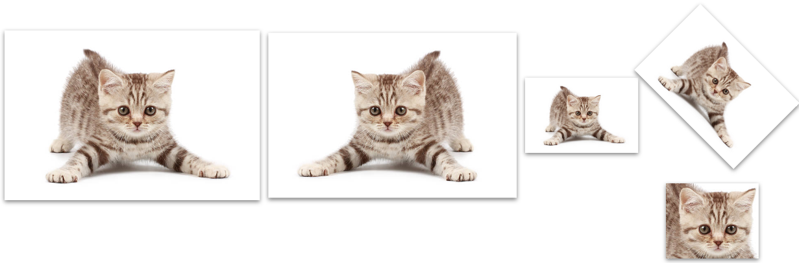

Получается, использовать персептрон для обработки изображений – не самая лучшая идея. Есть ли альтернативы?
## Операция свертки

Такая альтернатива есть – применение сверточных слоев, в основе которых лежит идея применять к изображению операцию *свертки*. 

Попробуем сначала понять её смысл, не погружаясь глубоко в математический анализ. 
### Фильтры в классическом машинном зрении

В классическом компьютерном зрении существует множество алгоритмов, позволяющих выполнять различные полезные преобразования изображений. Например, мы можем удалить шум с фотографии, размыть изображение или выделить границы объектов. Такие преобразования часто выполняются с помощью **фильтров**.

Рассмотрим один из самых простых примеров – **усредняющий фильтр**, который позволяет сглаживать изображение и уменьшать некоторые виды шума.
#### Как работает усредняющий фильтр?

Предположим, что мы хотим изменить яркость некоторого пикселя изображения. Вместо того чтобы использовать только его собственное значение, мы можем посмотреть на соседние пиксели и вычислить их среднюю яркость.

Например, рассмотрим следующую область изображения размером 3 × 3 пикселя:
$$  
\begin{pmatrix}  
0 & 0 & 0 \\  
0 & 1 & 0 \\  
0 & 0 & 0  
\end{pmatrix}  
$$
Здесь все пиксели чёрные, кроме центрального, яркость которого равна единице. Если заменить значение центрального пикселя средним арифметическим яркостей всех девяти пикселей, мы получим:

$$  
\frac{0+0+0+0+1+0+0+0+0}{9}  
=\frac{1}{9}\approx 0.11.  
$$

Таким образом, яркость центрального пикселя уменьшилась. Если аналогичную операцию выполнить для всех пикселей изображения, изолированные перепады яркости станут менее выраженными, а изображение – более сглаженным. Но ведь мы можем представить вычисление среднего арифметического несколько иначе!

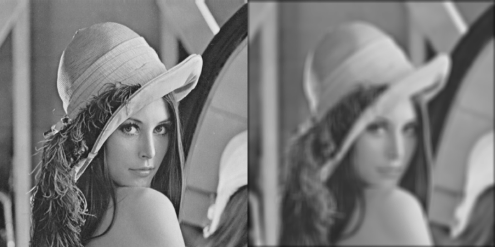

Для этого введём небольшую матрицу, которую будем называть **ядром фильтра**:
$$  
K=\frac{1}{9}  
\begin{pmatrix}  
1&1&1 \\  
1&1&1 \\  
1&1&1  
\end{pmatrix}  
$$
Теперь, чтобы получить новое значение пикселя, достаточно наложить ядро на соответствующую область изображения, перемножить попарно совпадающие элементы и сложить полученные произведения. Если последовательно перемещать ядро по всему изображению и повторять эту операцию, мы получим новое, сглаженное изображение.
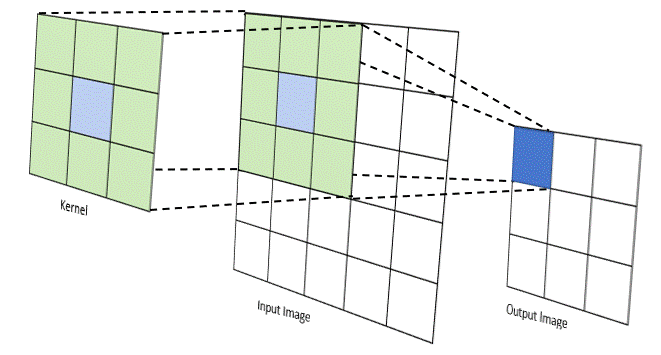

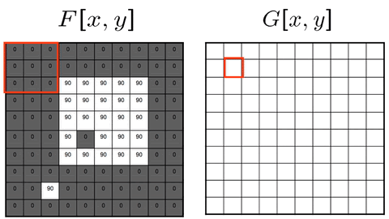

**Именно на таком принципе основана операция двумерной свёртки, используемая для обработки изображений.**

Обратите внимание, что никакого сложного преобразования здесь нет: мы просто многократно выполняем умножение и сложение чисел. Важно лишь то, **какие значения записаны в ядре фильтра**.
#### Разные ядра – разные преобразования

Мы рассмотрели усредняющий фильтр, но существуют и другие ядра, позволяющие выполнять совершенно разные операции. Например, можно подобрать коэффициенты так, чтобы фильтр усиливал границы объектов, выделял определённые текстуры или размывал изображение с различной интенсивностью. Таким образом, **именно значения коэффициентов ядра определяют, какое преобразование будет выполнять фильтр**.

В классических алгоритмах обработки изображений эти коэффициенты обычно подбираются заранее, исходя из того, какую задачу мы хотим решить. Однако у такого подхода есть очевидное ограничение. Мы должны заранее знать, какое преобразование изображения нам необходимо, и подобрать для него подходящие коэффициенты.

А теперь вспомним одну из основных идей глубокого обучения – **обучение скрытых признаков**.

> [!QUESTION] Вопрос  
> **А что, если мы хотим найти такие значения коэффициентов ядра, чтобы фильтр выделял не заранее определённые свойства изображения, а полезные для решения нашей задачи скрытые признаки?**
> 
> Например, признаки, позволяющие отличить кошку от собаки.

Вместо того чтобы самостоятельно придумывать значения коэффициентов, мы можем сделать их **обучаемыми параметрами нейронной сети** и находить в процессе обучения. Именно эта идея лежит в основе **свёрточных нейронных сетей (Convolutional Neural Networks, CNN)**.
## Двумерный сверточный слой

### Как он работает?

Следующая картинка поможет разобраться с устройством двумерного сверточного слоя:

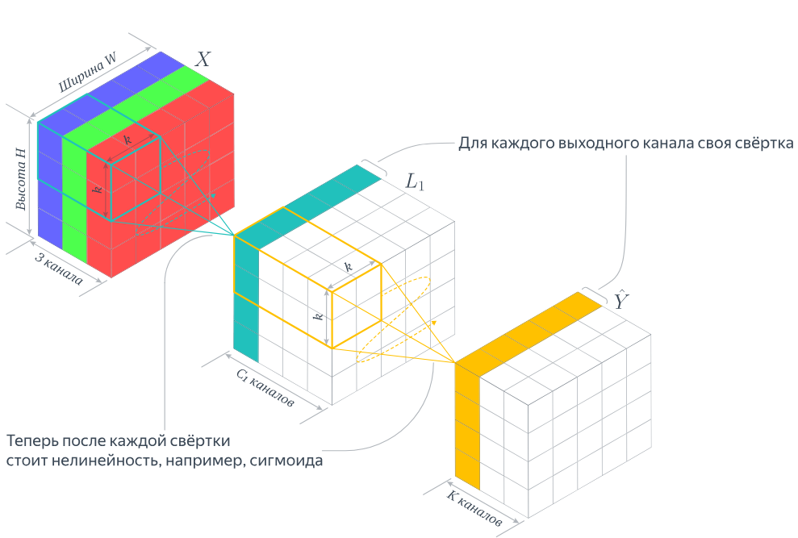
Каждый «кубик» на картинке – это число. Большой тензор слева – это изображение котёнка. Фиолетовым цветом на нём выделено окно, которое в настоящий момент участвует в операции свёртки с некоторым ядром.

Результатом этой операции будет новое число, которое на картинке отмечено голубым. Чтобы получить следующее число, окно нужно сдвинуть на один шаг вправо и повторить вычисления. Последовательно перемещая окно по всему изображению, мы сформируем новый двумерный массив чисел, который называется **картой признаков (feature map)**.

Вспомним, что в классическом компьютерном зрении значения коэффициентов ядра задавались заранее. Здесь же мы хотим, чтобы нейронная сеть самостоятельно находила такие коэффициенты, которые позволяют извлекать полезные для решения нашей задачи признаки.

Для этого достаточно сделать коэффициенты ядра **обучаемыми параметрами** нейронной сети.

> [!NOTE] Определение  
> **Свёрточный слой (convolutional layer)** – слой нейронной сети, который применяет к входным данным набор обучаемых свёрточных фильтров, формируя выходные карты признаков.

### Входные и выходные каналы

Пока мы рассматривали только одну карту признаков. Но что, если мы хотим одновременно выделять несколько разных признаков изображения?

Для этого можно использовать **несколько свёрточных фильтров**, каждый из которых будет формировать собственную карту признаков. Например, если мы используем 16 фильтров, то получим 16 выходных карт признаков. Вместе они образуют один трёхмерный тензор с 16 каналами.

Здесь есть одна важная особенность. Наше исходное изображение котёнка цветное, то есть содержит три канала – R, G и B. Поэтому каждый фильтр должен обрабатывать **все три входных канала**, а не только один из них.

Для этого фильтр содержит отдельный набор коэффициентов для каждого входного канала. Результаты вычислений по всем каналам суммируются, после чего получается одна выходная карта признаков.

Таким образом:
- **Количество входных каналов** определяет, сколько каналов данных обрабатывает каждый фильтр.
- **Количество выходных каналов** определяет, сколько разных фильтров мы используем и, соответственно, сколько карт признаков получим.

> [!NOTE] Небольшое уточнение  
> После свёрточного слоя обычно применяется **функция активации**, например ReLU, которая добавляет нелинейность в преобразование данных. Однако сама операция свёртки нелинейность не содержит – в PyTorch её необходимо добавлять отдельно.

### Практический пример на PyTorch

Попробуем создать свёрточный слой, который принимает цветное изображение и формирует 16 выходных каналов.

```python
import torch
from torch import nn

# Пакет из 8 цветных изображений 32 × 32
x = torch.randn(8, 3, 32, 32)

# Создадим свёрточный слой
conv = nn.Conv2d(
    in_channels=3,
    out_channels=16,
    kernel_size=3,
    padding=1
)

y = torch.relu(conv(x))

print(y.shape)           # (8, 16, 32, 32)
print(conv.weight.shape) # (16, 3, 3, 3)
```

Обратим внимание на размерности:

- `8` – количество изображений в пакете;
- `3` – количество входных каналов (RGB);
- `16` – количество выходных каналов;
- `3 × 3` – пространственный размер ядра свёртки.

На выходе мы получили 16 карт признаков размером 32 × 32 для каждого изображения. Размер изображений не изменился благодаря параметру `padding=1`, с которым мы подробнее познакомимся чуть позже.

Важный момент: **все 16 фильтров используют собственные обучаемые коэффициенты**. В ходе обучения нейронной сети они будут изменяться так, чтобы извлекать признаки, полезные для решения поставленной задачи.

Сам по себе приведённый код ещё ничего не обучает: мы лишь создали слой со случайно инициализированными коэффициентами и выполнили прямой проход.
### Сколько параметров у свёрточного слоя?

Вернёмся к нашему примеру c **Full HD** разрешением изображения (1920 × 1080 пикселей). Пусть мы хотим применить к нему свёрточный слой с 16 выходными каналами и ядрами размером 3 × 3. Каждый из 16 фильтров содержит три матрицы коэффициентов размером 3 × 3 – по одной для каждого входного канала RGB.Следовательно, в одном фильтре будет:
$$  
3\cdot3\cdot3=27  
$$
обучаемых коэффициентов. Кроме того, для каждого выходного канала обычно используется ещё один обучаемый параметр – **смещение (bias)**. Получается, что общее количество параметров слоя составляет:
$$  
16\cdot(27+1)=\boxed{448}.  
$$
Для проверки воспользуемся PyTorch:

```python
import torch
from torch import nn

# Одно RGB-изображение Full HD
x = torch.randn(1, 3, 1080, 1920)

conv = nn.Conv2d(
    in_channels=3,
    out_channels=16,
    kernel_size=3,
    padding=1
)

y = conv(x)

print(y.shape)
# torch.Size([1, 16, 1080, 1920])

print(sum(p.numel() for p in conv.parameters()))
# 448
```

Обратите внимание: на выходе мы получили **16 карт признаков разрешением 1920 × 1080 пикселей**, но для их вычисления использовали всего **448 обучаемых параметров**!

Как такое возможно? Дело в том, что одни и те же коэффициенты ядра последовательно применяются ко всем участкам изображения. Этот принцип называется **разделением параметров (parameter sharing)**.

Получается, что количество параметров обычного свёрточного слоя зависит от числа входных и выходных каналов и размера ядра, **но не зависит от разрешения изображения**.

> [!IMPORTANT] Важное замечание  
> Это не означает, что обработка изображений высокого разрешения не требует дополнительных вычислительных ресурсов.
> 
> При увеличении разрешения возрастает количество операций и объём памяти, необходимый для хранения промежуточных карт признаков. Однако количество **обучаемых параметров** самого свёрточного слоя остаётся прежним.
> [!NOTE]- Общая формула количества параметров  
> Для обычного свёрточного слоя (`groups=1`) с обучаемыми смещениями количество параметров вычисляется по формуле:
>
> $$  
> N_{\text{params}} =  
> C_{\text{out}}(C_{\text{in}}k_hk_w+1),  
> $$
> 
> где:
> 
> - $C_{\text{in}}$ – количество входных каналов;
>     
> - $C_{\text{out}}$ – количество выходных каналов;
>     
> - $k_h$, $k_w$ – высота и ширина ядра свёртки.
>     
> 
> Если смещения отключены (`bias=False`), единицу в скобках следует убрать.

Заметим интересную особенность: **количество параметров свёрточного слоя не зависит от высоты и ширины входного изображения**. Это возможно благодаря тому, что одни и те же коэффициенты фильтра используются при обработке разных участков изображения. Такой принцип называется **разделением параметров (parameter sharing)**.

Именно он позволяет свёрточным сетям эффективно обрабатывать изображения, сохраняя сравнительно небольшое количество обучаемых параметров. Теперь нам осталось разобраться с тем, как управлять размером выходной карты признаков, шагом перемещения ядра и областью изображения, которую охватывает свёртка.
### Параметры двумерной свертки

Основными параметрами, определяющими работу двумерного сверточного слоя, являются:
- **`kernel_size`** – пространственный размер ядра, например $3\times3$.
- **`stride`** – величина шага, с которым ядро свертки перемещается по входному изображению. Страйд, равный 1, означает, что окно смещается на один пиксель за раз, сохраняя высокую детализацию. Увеличение страйда (например, до 2) уменьшает разрешение выходной карты признаков вместе с вычислительными затратами.
- **`padding`** – добавление пикселей (обычно нулевых) по границам входного изображения. Это позволяет контролировать размер выходной карты признаков. Например, при ядре $3\times3$, `stride=1`, `dilation=1` значение `padding=1` сохраняет высоту и ширину. Следует различать:
	- _Valid_-padding (без дополнений) приводит к уменьшению размера
	- _Same_-padding (с определенным количеством пикселей по краям) сохраняет исходный размер, что часто является желаемым результатом.
- **`dilation`** – параметр, который "разрежает" ядро свертки, добавляя промежутки между его элементами. Это позволяет увеличить рецептивное поле (речь о котором пойдет ниже) свертки без увеличения количества параметров или потери разрешения, помогая сети найти более глобальные контексты и зависимости.

По этой [ссылке ](https://github.com/vdumoulin/conv_arithmetic)можно увидеть иллюстрации того, как разная комбинация значений этих параметров меняет вид операции свертки.

Для квадратного ядра размера $k$ и одинаковых параметров по двум осям высота выходной карты признаков равна

$$
H_{out}=\left\lfloor\frac{H_{in}+2p-d(k-1)-1}{s}+1\right\rfloor,
$$
 где $k$ – размер ядра свертки
- $s$ – stride (шаг)
- $p$ – padding (дополнение)
- $d$ – dilation (коэффициент расширения)
- $\lfloor \cdot \rfloor$ – операция округления вниз

Аналогично вычисляется $W_{out}$. Параметры по высоте и ширине могут различаться.

> [!NOTE] Уточнение про `same`
> Термин *same* означает сохранение (или определённое правило расчёта) пространственного размера в зависимости от библиотеки и `stride`. В `torch.nn.Conv2d` значение `padding="same"` **не поддерживает `stride`, отличный от 1**. Поэтому для первого знакомства надёжнее разбирать численный `padding`.

### Рецептивное поле

> [!NOTE] Определение
>  **Рецептивное поле (Receptive field)** – это размер области входного изображения, которая участвует в вычислении одного элемента выходной карты признаков.

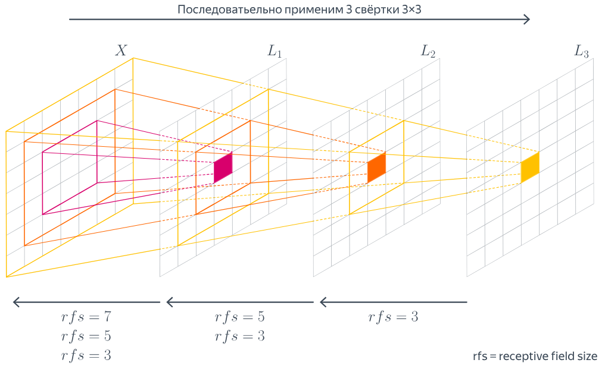

Ключевой способ увеличить рецептивное поле, не меняя размер ядра, – это последовательное наложение многих сверточных слоев. Каждый следующий слой "смотрит" на все б**о**льшую область исходного изображения. Например, композиция двух сверток 3x3 дает рецептивное поле 5x5, а трех – 7x7. Это позволяет нейронам на глубоких слоях охватывать **глобальный контекст**, одновременно сокращая количество параметров по сравнению с полносвязными сетями. Альтернативный способ увеличить рецептивное поле – использование **dilated-сверток**, которые увеличивают зону охвата за счет разреженного ядра с промежутками между элементами.

>[!NOTE] О разнице между **теоретическим** и **эффективным** рецептивным полем
>Важно различать **теоретическое** рецептивное поле, определяемое архитектурой, и **эффективное** рецептивное поле: на практике разные входные пиксели могут влиять на выход с разной силой. Чтобы сеть учитывала действительно большой контекст, недостаточно произнести слово «глубокая»: это зависит от количества слоёв, их параметров и всей архитектуры.
### Формальное определение

На картинке ниже приведена формальная математическая запись вычисления нового значения в карте признаков с помощью свертки:

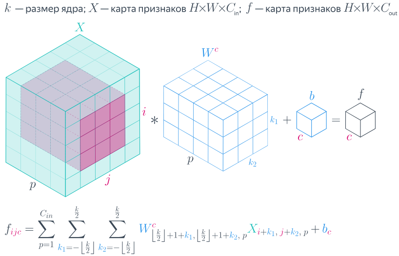
## Пулинг

Мы уже знаем, что с помощью свёрточных слоёв можно формировать карты признаков с произвольным количеством каналов. Увеличивая их число, мы позволяем нейронной сети извлекать больше различных признаков изображения. Однако здесь возникает проблема: чем больше каналов и чем выше разрешение промежуточных карт признаков, тем больше вычислений и оперативной памяти требуется для их обработки.

Можно ли уменьшить эти затраты, сохранив уже найденные признаки?

Для этого в свёрточных нейронных сетях часто используют **пулинг (pooling)** – операцию уменьшения пространственного разрешения карт признаков.

Например, мы можем уменьшить карту признаков размером 1920 × 1080 до 960 × 540, сохранив прежнее количество каналов. При этом количество значений, которые нужно хранить и обрабатывать, уменьшится в четыре раза. Как это сделать?

Самый простой способ – оставлять только значения с чётными индексами, отбрасывая остальные. Однако в таком случае мы можем потерять ценную информацию. Тогда возникает вопрос: **по какому принципу выбирать значения, чтобы сохранить как можно больше полезной информации?**
### Max Pooling

Пусть у нас есть небольшое окно, например, размером 2 × 2. Вместо того чтобы просто отбросить часть значений, мы можем выбрать **максимальное значение** внутри каждого такого окна. Этот способ называется **Max Pooling (максимальный пулинг)**.

Предположим, что в некоторой области карты признаков находятся следующие значения:
$$  
\begin{pmatrix}  
0.1 & 0.3 \\  
0.8 & 0.2  
\end{pmatrix}  
$$
После применения Max Pooling мы оставим только максимальное значение – **0.8**.

Почему это может быть полезно? Вспомним, что значения в карте признаков могут характеризовать наличие определённого признака изображения. Например, один из фильтров может сильно реагировать на границы объектов.

В таком случае Max Pooling позволяет сохранить наиболее сильный отклик фильтра внутри небольшой области, даже если точное положение этого отклика немного изменилось.
### Average Pooling

А что, если вместо максимального значения вычислять среднее арифметическое всех значений внутри окна? Получится другой способ – **Average Pooling (усредняющий пулинг)**.

Для предыдущего примера результат будет равен:
$$  
\frac{0.1+0.3+0.8+0.2}{4}=0.35.  
$$
В отличие от Max Pooling, который сохраняет наиболее сильный отклик, Average Pooling учитывает все значения внутри окна и усредняет их.

Таким образом, эти два способа по-разному обобщают информацию:
- **Max Pooling** сохраняет наиболее сильный отклик в рассматриваемой области.
- **Average Pooling** сохраняет среднее значение откликов.

Оба метода уменьшают пространственное разрешение карты признаков, не изменяя количество каналов. При этом сами операции пулинга не содержат обучаемых коэффициентов.

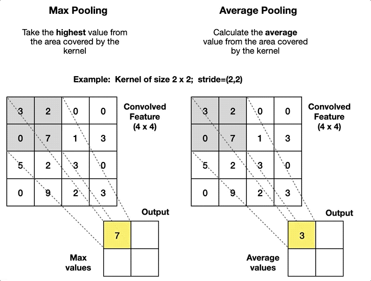

> [!IMPORTANT] Важное замечание  
> Пулинг уменьшает объём промежуточных данных и вычислительные затраты последующих слоёв. Однако сам по себе он не уменьшает количество параметров свёрточных слоёв: оно определяется размерами ядер и количеством входных и выходных каналов.
> 
> Если же после пулинга используется полносвязный слой, уменьшение размера карты признаков может значительно сократить количество его параметров.
### Global Average Pooling

Решая задачу классификации или регрессии, нам в конце концов нужно перейти от многоканальной карты признаков к вектору, который можно подать на вход линейному слою, отвечающему за предсказание целевой переменной. Как это сделать?

**Первый способ.** Можно просто развернуть последнюю карту признаков в один длинный вектор и передать его полносвязному слою.

Однако здесь возникает знакомая нам проблема: если карта признаков имеет большое пространственное разрешение, то и вектор получится очень длинным. Следовательно, полносвязному слою потребуется большое количество обучаемых параметров. Кроме того, размер такого слоя будет зависеть от разрешения карты признаков.

Конечно, мы можем построить свёрточную сеть так, чтобы её последняя карта признаков имела размер 1 × 1 × C. В таком случае проблема исчезнет, но нам придётся тщательно подбирать архитектуру, чтобы получить нужные пространственные размеры.

**Второй способ.** А что, если вместо этого просто вычислить среднее значение каждого канала последней карты признаков?

Предположим, что у нас есть карта признаков размером `C × H × W`. Мы вычисляем среднее арифметическое всех `H × W` значений отдельно для каждого из `C` каналов. В результате получаем вектор длиной `C`, независимо от исходного пространственного разрешения карты признаков. Это и есть **Global Average Pooling (глобальный усредняющий пулинг)**.

У такого подхода есть несколько преимуществ:
1. **Меньше обучаемых параметров.** Вместо большого полносвязного классификатора можно использовать небольшой линейный слой, принимающий всего `C` значений.
2. **Независимость размера выходного вектора от пространственного разрешения.** Независимо от высоты и ширины карты признаков, Global Average Pooling всегда возвращает по одному значению на канал.
3. **Меньшая чувствительность к положению признаков.** Для глобального усреднения важнее, насколько сильно признак проявляется на изображении в целом, а не в какой именно точке он обнаружен.

Последнее свойство особенно полезно для классификации изображений, когда нам важно определить, **что изображено**, а не точное расположение объекта.

Однако у него есть и обратная сторона: после глобального усреднения мы теряем информацию о пространственном положении признаков. Поэтому для задач, где важно точно определить расположение объектов, например сегментации, такой подход не всегда подходит.

В PyTorch Global Average Pooling можно реализовать буквально одной строкой:

```python
from torch import nn

gap = nn.AdaptiveAvgPool2d(1)

# C × H × W → C × 1 × 1
```

После этого результат можно развернуть в вектор длиной `C` с помощью `torch.flatten`.

Таким образом, пулинг позволяет управлять пространственным разрешением карт признаков, сокращать вычислительные затраты и, в некоторых архитектурах, уменьшать количество обучаемых параметров.

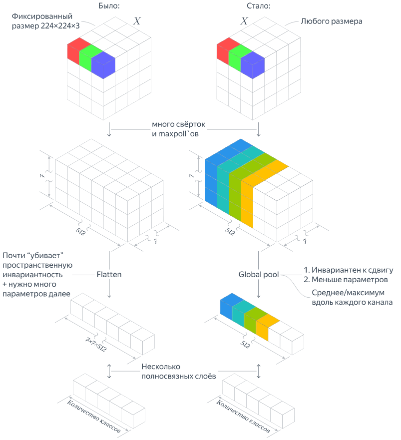

## От отдельных слоёв к первой свёрточной сети

Мы познакомились с основными строительными блоками CNN: свёрточными слоями, функциями активации и пулингом. Но пока мы использовали их по отдельности. А как из этих элементов собрать нейронную сеть, которая действительно решает какую-нибудь задачу?

Начнём с классификации изображений. Представим, что мы хотим определить, какой объект изображён на фотографии: кошка, автомобиль, самолёт и так далее. Значит, наша сеть должна принимать изображение и возвращать по одному числу для каждого рассматриваемого класса.

Как организовать такое преобразование?
1. Несколькими свёрточными слоями будем последовательно извлекать признаки изображения.
2. Периодически уменьшим разрешение карт признаков с помощью пулинга, чтобы сократить вычисления.
3. С помощью Global Average Pooling превратим последние карты признаков в вектор.
4. Наконец, линейным слоем получим оценки для каждого класса.
### Практический пример: соберём MiniCNN

Попробуем реализовать эту идею на PyTorch.

```python
import torch
from torch import nn

class MiniCNN(nn.Module):
    def __init__(self):
        super().__init__()
        self.features = nn.Sequential(
            nn.Conv2d(3, 16, kernel_size=3, padding=1),
            nn.ReLU(),
            nn.MaxPool2d(2),
            nn.Conv2d(16, 32, kernel_size=3, padding=1),
            nn.ReLU(),
            nn.MaxPool2d(2),
        )
        self.classifier = nn.Sequential(
            nn.AdaptiveAvgPool2d(1),
            nn.Flatten(),
            nn.Linear(32, 10),
        )

    def forward(self, x):
        x = self.features(x)
        return self.classifier(x)

model = MiniCNN()
images = torch.randn(8, 3, 32, 32)
print(model(images).shape)  # torch.Size([8, 10])
```

В данном случае сеть получает восемь цветных изображений размером 32 × 32 пикселя и для каждого возвращает десять чисел. Пока это не вероятности, а **оценки классов (logits)**. При обучении с `CrossEntropyLoss` дополнительно применять `Softmax` не нужно.

Обратим внимание, что мы намеренно взяли маленькие изображения. Ранее мы рассматривали Full HD, чтобы разобраться в количестве параметров свёртки. Но для первого учебного эксперимента изображения 32 × 32 гораздо удобнее: на них быстрее проверять гипотезы и запускать обучение даже без мощной видеокарты.
## Как обучать модель на изображениях

Сеть у нас появилась, но её коэффициенты пока инициализированы случайно. Значит, никакие полезные признаки она ещё не научилась выделять. Для обучения нам понадобятся изображения с правильными ответами, функция потерь и алгоритм оптимизации (оптимизатор).

Воспользуемся учебным набором [CIFAR-10](https://www.cs.toronto.edu/~kriz/cifar.html). Он содержит небольшие цветные изображения размером 32 × 32 пикселя, относящиеся к десяти классам. Такой набор вполне подходит для нашего первого знакомства.
### Аугментации: откуда взять больше разнообразных примеров?

Допустим, мы хотим научить сеть распознавать кошек. Для нас очевидно, что кошка не перестанет быть кошкой, если немного сдвинуть фотографию, изменить её яркость или отразить по горизонтали. Но нейронная сеть должна научиться этому на примерах. Один из способов помочь ей – **искусственно изменять изображения во время обучения**, сохраняя правильные метки. Такие преобразования называются **аугментациями (data augmentation)**.

Например, можно случайным образом обрезать фотографию, немного повернуть её или отразить. При каждом обращении к одному и тому же обучающему изображению сеть может получать несколько изменённый вариант.

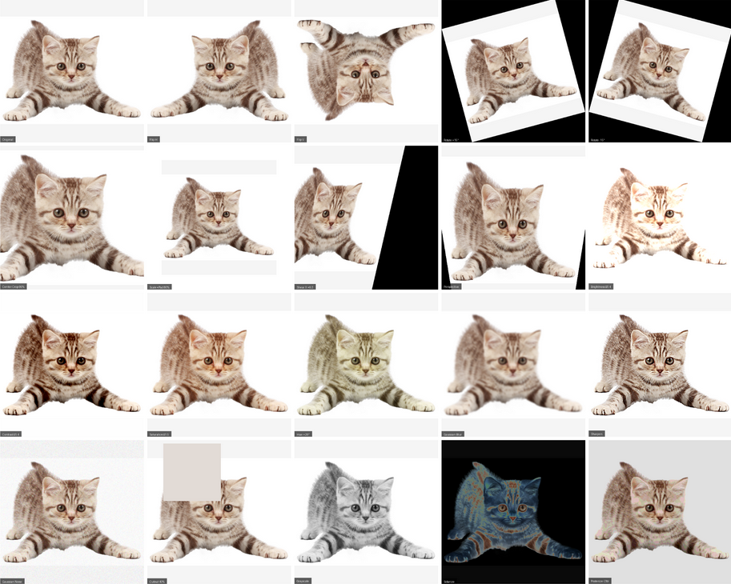

Однако здесь важно помнить: **аугментация должна сохранять смысл правильного ответа**. Горизонтальное отражение фотографии кошки обычно допустимо, а вот отражение рукописной цифры может изменить её значение. В задачах детекции и сегментации вместе с изображением необходимо преобразовывать и разметку  – рамки или маски объектов.

Посмотрим, как это выглядит в `torchvision`:
```python
from torchvision import transforms

train_transform = transforms.Compose([
    transforms.RandomCrop(32, padding=4),
    transforms.RandomHorizontalFlip(),
    transforms.ToTensor(),
])

eval_transform = transforms.ToTensor()
```

Здесь для обучающих изображений мы случайно выбираем область 32 × 32 после добавления полей и иногда отражаем изображение по горизонтали. Для проверки качества используем обычное, неизменяемое преобразование в тензор: иначе результаты разных проверок будет сложнее сравнивать.

> [!NOTE] Важное замечание
> Аугментации обычно применяют только к **обучающим** данным. Валидационные и тестовые примеры не должны случайно изменяться при каждой оценке. Если добавляем нормализацию по среднему и стандартному отклонению, её параметры рассчитывают по обучающей части данных.
### Практический пример: один шаг обучения

Теперь попробуем обучить нашу `MiniCNN` хотя бы на одном батче изображений.

```python
from torch.utils.data import DataLoader
from torchvision.datasets import CIFAR10

train_ds = CIFAR10(
    root="./data",
    train=True,
    download=True,
    transform=train_transform,
)
loader = DataLoader(train_ds, batch_size=32, shuffle=True)

images, labels = next(iter(loader))

criterion = nn.CrossEntropyLoss()
optimizer = torch.optim.Adam(model.parameters(), lr=1e-3)

model.train()
optimizer.zero_grad()
logits = model(images)         # 32 изображения × 10 классов
loss = criterion(logits, labels)
loss.backward()
optimizer.step()

print(f"Loss на первом шаге: {loss.item():.3f}")
```

Здесь не появилось никаких принципиально новых действий: мы уже знакомы с прямым проходом, вычислением функции потерь, обратным распространением ошибки и обновлением параметров. Изменилось только устройство модели и тип данных, которые мы подаём ей на вход.

Разумеется, **одного шага недостаточно, чтобы получить обученную сеть**. Для этого потребуется многократно проходить по обучающим данным, следить за качеством на отдельной валидационной выборке, а окончательный результат оценивать на тестовом наборе. По значению `loss` после одного шага делать вывод о качестве модели нельзя.

> [!QUESTION] Идея небольшого эксперимента
> Обучите одну и ту же `MiniCNN` с аугментациями и без них. При одинаковых разбиении данных, числе эпох и остальных настройках сравните точность на обучающей и валидационной выборках. Всегда ли улучшение качества на обучающих данных означает улучшение качества на новых изображениях?
## Как устроены более глубокие свёрточные нейронные сети

Мы научились собирать простую CNN из знакомых слоёв. Но что делать, если нескольких свёрток недостаточно для решения сложной задачи? Казалось бы, ответ очевиден: добавить больше слоёв, больше каналов и обучать сеть на большем количестве изображений.

Именно так во многом и развивались свёрточные архитектуры. Однако при увеличении глубины возникали новые проблемы, для решения которых приходилось придумывать более интересные способы организации слоёв.
### Надо понимать всю глубину наших глубин: от LeNet до VGG

Один из ранних известных примеров CNN – **LeNet-5**, использовавшаяся для распознавания рукописных цифр. В 2012 году **AlexNet** показала, насколько эффективными могут быть глубокие свёрточные сети на большом наборе изображений ImageNet.

Позднее в архитектуре **VGG** широко применили простую идею: вместо крупных свёрточных ядер последовательно использовать небольшие ядра 3 × 3. Несколько таких слоёв позволяют постепенно расширять область изображения, влияющую на выходной признак, и добавлять нелинейные преобразования.

Однако делать сеть всё глубже простым добавлением слоёв не всегда удобно. Поэтому исследователи стали менять не только количество слоёв, но и **способы их соединения**.
### Inception: изучение изображения на разных масштабах

Представим, что для распознавания объекта нам нужны и мелкие детали, и более крупные фрагменты изображения. Какой размер свёрточного ядра тогда выбрать?

В архитектуре **Inception** предложили не ограничиваться одним вариантом: выполнять несколько преобразований **параллельно**, а затем объединять полученные карты признаков. Например, одна ветвь может использовать небольшие ядра, другая – более крупные, а третья – пулинг.

В таких блоках также используются свёртки размером 1 × 1. Они позволяют менять количество каналов и, в частности, уменьшать вычислительные затраты перед более дорогими преобразованиями.
### ResNet: нормальные герои всегда идут в обход

При обучении очень глубоких сетей обнаруживается ещё одна проблема: добавление слоёв само по себе не гарантирует улучшения результата. Обучать такие сети становится сложнее.

В архитектуре **ResNet** предложили довольно простую, но важную идею: **передавать вход блока напрямую к его выходу**, а вычисленные внутри блока признаки использовать как дополнительную поправку. Если обычный блок вычисляет некоторую функцию $F(x)$, то остаточный блок (*residual block*) возвращает:
$$
y=x+F(x).
$$
Получается, что блок не обязан каждый раз полностью заменять уже найденное представление: он может научиться добавлять к нему только то, что действительно нужно. Кроме того, такая связь создаёт более прямой путь распространения градиента при обучении.

Попробуем написать простейший остаточный блок:

```python
class ResidualBlock(nn.Module):
    def __init__(self, channels):
        super().__init__()
        self.branch = nn.Sequential(
            nn.Conv2d(channels, channels, 3, padding=1),
            nn.ReLU(),
            nn.Conv2d(channels, channels, 3, padding=1),
        )

    def forward(self, x):
        return x + self.branch(x)

block = ResidualBlock(channels=16)
x = torch.randn(2, 16, 8, 8)
print(block(x).shape)  # torch.Size([2, 16, 8, 8])
```

Это учебное упрощение: в настоящих ResNet-блоках также используются нормализация и дополнительные функции активации. Пока нам важен сам принцип сложения. Очевидно, что для такого сложения формы двух тензоров должны совпадать (или быть специально согласованы).

> [!QUESTION] На подумать
> Почему нельзя непосредственно сложить карты признаков размером `(16, 16, 16)` и `(32, 8, 8)`? Каким преобразованием можно согласовать количество каналов и пространственное разрешение?

### DenseNet: переиспользование карт признаков

В **DenseNet** развили похожую мысль: зачем заставлять каждый новый слой заново извлекать признаки, которые уже были обнаружены предыдущими?

Однако здесь выходы не **складываются**, как в ResNet, а **объединяются по оси каналов** (*конкатенируются*). Поэтому новые слои могут получать доступ к признакам нескольких предшествующих слоёв.

```python
x = torch.randn(2, 16, 16, 16)
new_features = nn.Conv2d(16, 8, 3, padding=1)(x)

print(torch.cat([x, new_features], dim=1).shape)
# torch.Size([2, 24, 16, 16])
```

В нашем примере было 16 каналов, к которым мы добавили ещё 8, – и получили 24. Это не полноценная DenseNet, а иллюстрация принципа объединения карт признаков.

Если захочется посмотреть, как все эти идеи собираются в полноценные архитектуры, рекомендую [UvA Deep Learning Notebooks: Inception, ResNet and DenseNet](https://uvadlc-notebooks.readthedocs.io/en/latest/tutorial_notebooks/tutorial5/Inception_ResNet_DenseNet.html). Там есть реализация блоков и сравнение моделей на CIFAR-10.

> [!NOTE] А разве все современные модели компьютерного зрения свёрточные?
> Нет. Существуют и **Vision Transformers (ViT)**, которые разбивают изображение на фрагменты (*patches*) и обрабатывают их с помощью механизма внимания (*attention*). Есть также модели, сочетающие свёртки и внимание. Но понимание CNN остаётся полезным: локальные признаки, пространственные представления и способы их объединения встречаются во множестве современных архитектур.

## Основные задачи компьютерного зрения

До сих пор мы преимущественно говорили о **классификации**: подаём изображение на вход и получаем ответ, к какому классу оно относится. Но ведь изображения можно обрабатывать и иначе!

Представим фотографию городской улицы, на которой находятся несколько автомобилей и пешеходов. Что именно мы могли бы попросить определить нейронную сеть?
### Классификация: **что** изображено?

Самый простой вариант – присвоить всей фотографии одну метку, например «городская улица». В привычной задаче **многоклассовой классификации** модель выбирает один класс из фиксированного набора.

В этом случае мы уже знаем одну метрику качества – **accuracy**, долю правильных ответов. Но у неё есть ограничение: если в наборе 90 фотографий автомобилей и только 10 фотографий велосипедов, модель, которая *всегда* отвечает «автомобиль», получит 90 % accuracy, хотя велосипеды не распознаёт вообще.

Поэтому дополнительно часто рассматривают **precision**, **recall** и **F1**. Они помогают понять, какие классы модель находит хорошо, а какие – пропускает или путает с другими. Для многоклассовой задачи обычно также указывают способ усреднения метрик, например *macro-F1*.

> [!NOTE] А если на изображении несколько объектов разных классов?
> Иногда нам нужно не выбрать единственную метку, а отметить все подходящие: например, «автомобиль», «пешеход», «велосипед». Это уже **мультиметочная классификация (multi-label classification)** – отдельная постановка задачи.

### Детекция объектов: **что** находится на изображении **и где** именно?

Теперь усложним задачу. Мы хотим не просто понять, что на фотографии есть автомобили, а **найти каждый из них и указать его положение**.

Для этого модель должна возвращать набор объектов: для каждого – класс, ограничивающую рамку (*bounding box*) и оценку уверенности. Такая задача называется **детекцией объектов (object detection)**.

Но как оценить качество предсказанной рамки? Один из способов – посмотреть, насколько она совпадает с правильной разметкой. Для этого используют **Intersection over Union (IoU)** – отношение площади пересечения двух рамок к площади их объединения:
$$
\mathrm{IoU}(B_p,B_{gt})=\frac{|B_p\cap B_{gt}|}{|B_p\cup B_{gt}|}.
$$
Если рамки полностью совпали, IoU равен 1. Если вообще не пересекаются – 0. Например, при площади пересечения 30 условных единиц и площади объединения 50 условных единиц получим $\mathrm{IoU}=0.6$.

Однако здесь есть важная тонкость: детектор должен не только правильно располагать рамки, но и **находить все объекты, не создавая лишних срабатываний**. Поэтому одного IoU недостаточно для оценки всей модели. Обычно используют **AP** и **mAP**, которые учитывают баланс точности и полноты обнаружения объектов при заданных правилах сопоставления рамок.

Известные семейства детекторов: **Faster R-CNN**, **YOLO** и модели на основе трансформеров, например **DETR**. Они по-разному организуют поиск объектов, но решают общую задачу – определить *что* и *где*.
### Семантическая сегментация: а **где проходит граница** каждого объекта?

Ограничивающая рамка позволяет приблизительно указать положение объекта. Но что делать, если нам нужно точно определить его форму? Например, выделить все пиксели дороги, тротуара, автомобилей и пешеходов.

В этом случае используют **семантическую сегментацию (semantic segmentation)**: модель должна присвоить **каждому пикселю** одну из рассматриваемых меток классов.

Для оценки качества можно сравнить предсказанную маску с правильной. Как и при детекции, нам пригодится IoU – только теперь мы считаем пересечение и объединение **областей из пикселей**, принадлежащих выбранному классу.

Для конкретного класса обозначим:
- $TP$ – количество правильно найденных пикселей класса;
- $FP$ – количество пикселей, ошибочно отнесённых к этому классу;
- $FN$ – количество пикселей этого класса, пропущенных моделью.

Тогда две популярные метрики имеют вид:
$$
\mathrm{IoU}=\frac{TP}{TP+FP+FN},\qquad
\mathrm{Dice}=\frac{2TP}{2TP+FP+FN}.
$$

Например, если мы правильно нашли два пикселя, один лишний ошибочно включили в маску и ещё один пропустили, то получим $\mathrm{IoU}=0.5$, а $\mathrm{Dice}\approx0.67$.

> [!EXAMPLE]- Вычислим метрики с помощью PyTorch
> ```python
> import torch
>
> pred = torch.tensor([[1, 1, 0], [0, 1, 0]], dtype=torch.bool)
> target = torch.tensor([[1, 0, 0], [0, 1, 1]], dtype=torch.bool)
>
> tp = (pred & target).sum().item()
> fp = (pred & ~target).sum().item()
> fn = (~pred & target).sum().item()
>
> iou = tp / (tp + fp + fn)
> dice = 2 * tp / (2 * tp + fp + fn)
> print(f"IoU={iou:.3f}; Dice={dice:.3f}")
> # IoU=0.500; Dice=0.667
> ```
>
> Для нескольких классов метрики обычно усредняют; например, используют **mean IoU (mIoU)**. Также необходимо договориться, как обрабатывать случаи, когда определённого класса нет ни в предсказании, ни в разметке.

Какие архитектуры здесь применяют? Один из наиболее известных примеров – **U-Net**. Она сначала уменьшает пространственное разрешение карт признаков, чтобы извлечь более общие закономерности, а затем постепенно восстанавливает его. При этом промежуточные признаки с ранних слоёв передаются к соответствующим более поздним слоям, чтобы помочь сохранить детали границ объектов. Другие важные семейства – **FCN** и **DeepLab**.

> [!NOTE] Небольшое уточнение
> При семантической сегментации все пиксели автомобилей могут получить одну общую метку «автомобиль». Если требуется различать *конкретные экземпляры* машин, это уже задача **instance segmentation**.
## Небольшое отступление: одномерные свёртки

Мы познакомились со свёрткой на примере изображений, но сама идея перемещения ядра и вычисления взвешенной суммы гораздо шире. А что, если наши данные расположены не на двумерной плоскости, а вдоль **одной оси**, например оси времени?

Тогда можно использовать **одномерную свёртку (1D convolution)**. Вместо небольшого прямоугольного окна ядро последовательно перемещается вдоль временного ряда или последовательности отсчётов аудиосигнала.

В PyTorch для этого существует `nn.Conv1d`. Он принимает тензор формы `(N, C, L)`, где `L` – длина последовательности:

```python
waveforms = torch.randn(4, 1, 16000)  # четыре монофонических сигнала
layer = nn.Conv1d(1, 8, kernel_size=9, stride=2, padding=4)

print(layer(waveforms).shape)
# torch.Size([4, 8, 8000])
```

Мы получили восемь выходных каналов, а длина последовательности сократилась примерно вдвое благодаря `stride=2`. Подробно к обработке звука мы вернёмся в следующей лекции.

> [!NOTE]- Математическое отступление: свёртка и таяние снега
> У свёртки есть интересная интерпретация, которая вообще не связана с изображениями.
>
> Представим, что в разные моменты времени выпадает снег. Часть снега постепенно тает, причём снег, выпавший раньше, к текущему моменту успевает растаять сильнее. Как вычислить общее количество снега, которое осталось на земле?
>
> Пусть $g(\tau)$ – количество снега, выпавшего в момент времени $\tau$, а $f(t-\tau)$ – доля этого снега, оставшаяся к моменту $t$. Тогда количество оставшегося снега можно вычислить, сложив вклады всех предыдущих снегопадов:
>
> $$
> w(t)=\sum_{\tau=0}^{t}g(\tau)f(t-\tau).
> $$
>
> Например, если вчера выпало 10 кг снега, к сегодняшнему дню осталось 80 % от него, а сегодня выпало ещё 4 кг, то всего осталось $10\cdot0.8+4=12$ кг.
>
> Это пример **дискретной свёртки**: мы складываем результаты воздействия событий, произошедших в разные моменты времени, с учётом того, сколько времени прошло с каждого события.
>
> Ниже приведены три графика: количество выпавшего снега, доля снега, оставшаяся спустя некоторое время, и общее количество снега на земле с учётом таяния.
>
> 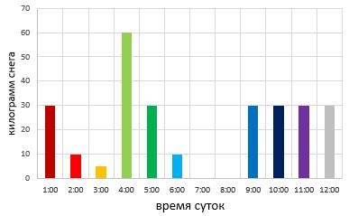
>
> 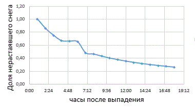
>
> 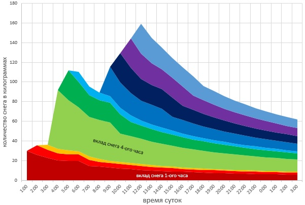
>
> Этот пример показывает, что математическая свёртка позволяет **складывать сдвинутые по времени вклады отдельных событий**. Для понимания работы CNN достаточно и более простого примера с усредняющим фильтром; подробная модель снегопада здесь приведена как дополнительное чтение.

## Что стоит запомнить

1. **Свёрточная сеть** – это не одна свёртка, а последовательность слоёв, которые постепенно формируют полезные признаки изображения.
2. **Аугментации** помогают модели видеть более разнообразные варианты обучающих примеров, но не должны менять правильную метку.
3. **Архитектуры CNN** отличаются не только глубиной, но и организацией связей между слоями: параллельные ветви Inception, сложение в ResNet, конкатенация в DenseNet.
4. **Постановка задачи определяет выход модели и метрики:** классификация – класс изображения, детекция – объекты и рамки, сегментация – классы пикселей.
5. Свёртку можно применять как к изображениям, так и к последовательностям, например аудиосигналам.
## Для самостоятельной работы

1. Для входа `3 × 64 × 64` проследите изменение размеров карт признаков в `MiniCNN`. Почему итоговый вектор содержит именно 10 значений?
2. Обучите `MiniCNN` на CIFAR-10, сравните эксперимент с аугментациями и без них. При сравнении зафиксируйте разбиение данных и другие настройки.
3. Объясните, чем поэлементное сложение признаков в ResNet отличается от конкатенации в DenseNet.
4. Придумайте реальную задачу, в которой классификации фотографии будет недостаточно, и потребуется детекция или сегментация.
5. Для примера с бинарными масками вручную вычислите $TP$, $FP$, $FN$, IoU и Dice.
## Источники и материалы

1. [Учебник ШАД – Свёрточные нейронные сети](https://education.yandex.ru/handbook/ml/article/svyortochnye-nejroseti).
2. [UvA Deep Learning Notebooks – Inception, ResNet and DenseNet](https://uvadlc-notebooks.readthedocs.io/en/latest/tutorial_notebooks/tutorial5/Inception_ResNet_DenseNet.html).
3. [Dive into Deep Learning – Convolutional Neural Networks](https://d2l.ai/chapter_convolutional-neural-networks/index.html).
4. [PyTorch – `nn.Conv2d`](https://docs.pytorch.org/docs/stable/generated/torch.nn.Conv2d.html).
5. [PyTorch – `nn.AdaptiveAvgPool2d`](https://docs.pytorch.org/docs/stable/generated/torch.nn.AdaptiveAvgPool2d.html).
6. [Torchvision – Image transformations](https://docs.pytorch.org/vision/stable/transforms.html).
7. [Convolution arithmetic – анимации параметров свёртки](https://github.com/vdumoulin/conv_arithmetic).
