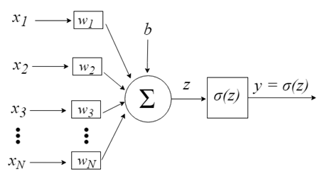
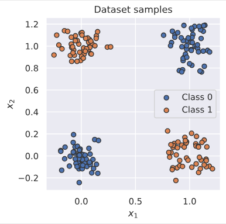
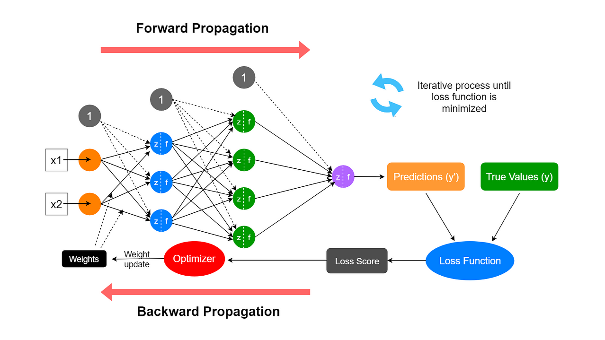

## Скрытые признаки

От **представления** данных зависит вероятность успеха решения задачи машинного обучения. Например, когда мы используем логистическую регрессию для рекомендации кесарева сечения для роженицы, мы не исследуем пациентку напрямую. Вместо этого мы узнаем о пациентке несколько важных сведений о её здоровье, например, о наличии или отсутствии рубца на матке. Каждый фрагмент информации, включенный в представление пациента, называется **признаком**.

Для многих задач можно придумать, “сконструировать” качественное **признаковое описание**, которое позволит решить её с помощью алгоритмов классического машинного обучения.

В то же время для множества задач составить признаковое описание не представляется возможным. В качестве примера можно рассмотреть задачу классификации котят манула и обычной домашней кошки. 

Для человека, знакомого с этими животными, не представляет труда отличить одно от другого. Если же мы попросим объяснить его, как именно он это сделал, то он, скорее всего, затруднится ответить на этот вопрос. Так мы можем предположить существование **скрытых признаков**, которые объективно существуют в реальности, но крайне сложны для формулирования в понятном для человека виде.

> [!TIP] Чуть подробнее о скрытых признаках
> Скрытые признаки часто не являются непосредственно наблюдаемыми величинами. Вместо этого они могут существовать как ненаблюдаемые объекты или ненаблюдаемые силы в физическом мире, которые влияют на наблюдаемые величины. Они также могут существовать как обобщенные паттерны и образы в человеческом разуме, которые дают полезные упрощающие объяснения или предполагаемые причины наблюдаемых явлений. Их можно рассматривать как концепции или абстракции, которые помогают нам понять смысл богатого разнообразия мира информации.

В этом случае возникает идея применять машинное обучение не только для поиска отображения признакового пространства в пространство целевой переменной (таргета), но и для поиска самого признакового представления (скрытых признаков). **Выученное представление** часто оказывается более информативным и релевантным для решения задачи, чем составленное человеком.

**Глубокое обучение** предлагает эффективный способ решения задачи **обучения представлений (скрытых признаков)**. Одной из базовых архитектур глубокого обучения является **многослойный персептрон**.

### Персептрон

> [!NOTE] Определение
> **Персептрон** (англ. perceptron от лат. perceptio – восприятие) – это простейшая математическая модель восприятия информации мозгом человека.

Рассмотрим персептрон с $N$ входами и одним выходом, $y$, которые связаны следующими вычислениями:
$$
z = f(x) = \sum^N_{i=1} w_ix_i + b = w^Tx + b
$$
Введем $\sigma(z)$  – нелинейную функция активации, тогда
$$
\hat{y} = \sigma(z)
$$
Другими словами, мы берем взвешенную сумму входов и подаем её на нелинейную функцию активации $\sigma$. Функция $f$ называется **линейным слоем**, потому что она вычисляет линейную функцию входов, $w^Tx$, плюс смещение, $b$. Функция $\sigma$ называется функцией активации, потому что она "решает", активируется ли нейрон.
## Почему одного персептрона недостаточно: задача XOR

Предыдущие рассуждения о скрытых признаках могут показаться слишком абстрактными. Для более глубокого и предметного понимания сути преимущества нейронных сетей можно рассмотреть "игрушечный" пример, иллюстрирующий способность нейронных сетей работать с нелинейными зависимостями в данных.
### Постановка задачи

Рассмотрим входные данные вила $x=(x_1,x_2)\in \{0,1 \}^2$ и целевую функцию:

$$
y=\text{XOR} (x_1,x_2)= \begin{cases} 
1, \text{ровно один из входов равен 1}, \\
0, \text{иначе}
\end{cases}
$$

Точки данных: $(0,0) \mapsto 0$, $(0, 1) \mapsto 1$,  $(1, 0) \mapsto 1$, $(1, 1) \mapsto 0$

Геометрически это вершины единичного квадрата: положительные примеры — это диагональная пара $(0,1)$ и $(1,0)$.

Если посмотреть на графическое изображение данных, сгенерированных с помощью данной путем добавления аддитивного шума
$$
\begin{aligned}
\bar{x}&\in\{0,1\}^2,\\
x&=\bar{x}+\varepsilon,\qquad
\varepsilon\sim\mathcal{N}(0,\sigma^2 I_2),\\
y&=\operatorname{XOR}(\bar{x}_1,\bar{x}_2).
\end{aligned}
$$
 становится интуитивно понятно, что представленные классы линейно не разделить.

### Ограничения линейной модели

Если мы не доверяем собственной интуиции, линейную неразделимость данных классов можно строго доказать. Пусть существует линейный классификатор:

$$
z(x) = w_1 x_1 + w_2 x_2 + b
$$
$$
\hat{y}=\mathbb{1}\{z(x) > 0\}
$$
Для каждой точки наших данных знак должен совпадать с “меткой класса”:

- для метки **1** $z(x)$ должен быть **больше нуля** ($z(x) > 0$)
- для метки **0** $z(x)$ должен быть **меньше или равен нулю** ($z(x) \leq 0$)

Это утверждение переводится в систему неравенств:

$$
\begin{aligned}
b &\leq 0,\\
w_1+b &>0,\\
w_2+b &>0,\\
w_1+w_2+b &\leq 0.
\end{aligned}
$$

1. Сложим второе и третье выражение: $(w_1+b)+(w_2+b)>0 \Rightarrow w_1+w_2+2b>0$
2. Сравним это с четверым: $w_1 + w_2 + b < 0$
3. Вычтем четвертое из результата п.1: $(w_1+w_2+2b) - (w_1 + w_2 + b) > 0 - 0 \Rightarrow b > 0$

Это же можно записать кратко:
$$
\underbrace{(w_1+b)}_{>0}
+\underbrace{(w_2+b)}_{>0}
-\underbrace{(w_1+w_2+b)}_{\leq 0}
=b>0.
$$
Мы получили **противоречие** с первым неравенством из нашей системы.
### Нелинейное решение с помощью многослойной сети

Рассмотрим персептрон с одним скрытым слоем и функцией активацией  $g(z) = \text{ReLU} = \max(0, z)$:

$$
h = g(Wx + c), \space \hat{y} = w^Th + b
$$

Именно нелинейность переводит точки в новое представление $h$, где есть возможность линейно разделить классы.

В явном виде решение будет выглядеть следующим образом:

$$
W = \begin{bmatrix} 
1 & 1 \\
1 & 1
\end{bmatrix}, 
\space
c = \begin{bmatrix} 
0 \\
-1
\end{bmatrix}, 
\space
w = \begin{bmatrix} 
1 \\
-2
\end{bmatrix}, 
\space
b = 0
$$

Рассмотрим его по шагам.

(1) Матрицы всех входов, взятых по столбцам:

$$
X = \begin{bmatrix}
0 & 0 & 1 & 1 \\
0 & 1 & 0 & 1
\end{bmatrix}
$$

(2) Перемножение матриц:

$$
WX = \begin{bmatrix} 
0 & 1 & 1 & 2 \\
0 & 1 & 1 & 2 \\
\end{bmatrix}
$$

(3) Прибавляем смещение:

$$
WX+c\mathbf{1}_4^T
=
\begin{bmatrix}
0 & 1 & 1 & 2 \\
-1 & 0 & 0 & 1
\end{bmatrix}
$$

(4) Применяем поэлементно функцию активации:

$$
H=\operatorname{ReLU}(WX+c\mathbf{1}_4^T).
$$

(5) Выход сети:

$$
\hat{y} = w^TH = \begin{bmatrix}
1 & -2
\end{bmatrix} \begin{bmatrix}
0 & 1 & 1 & 2 \\
0 & 0 & 0 & 1
\end{bmatrix} = \begin{bmatrix}
0 & 1 & 1 & 0\\
\end{bmatrix}
$$

Итого получаем правильные ответы для задачи XOR.

В данном примере мы подобрали параметры сети вручную. Однако для решения реальных задач такой подход практически неприменим: необходимо разработать алгоритм, позволяющий автоматически находить значения весов и смещений по обучающим данным.
## Прямой и обратный проход

В предыдущих разделах мы рассмотрели устройство многослойного персептрона и функции активации. Теперь разберёмся, как организованы вычисления при применении и обучении нейронной сети.

> [!NOTE] Определение
> **Прямой проход (forward pass, forward propagation)** — последовательное вычисление выходов слоёв нейронной сети по заданным входным данным.

На каждом слое выполняется аффинное преобразование, после которого, как правило, применяется функция активации:
$$  
\begin{aligned}  
a^{(0)} &= x,\\  
z^{(l)} &= W^{(l)}a^{(l-1)}+b^{(l)},\\  
a^{(l)} &= g^{(l)}(z^{(l)}).  
\end{aligned}  
$$
Таким образом, данные последовательно преобразуются от входного слоя к выходному, формируя предсказание модели $\hat{y}=a^{(L)}$.

При обучении нейронной сети это предсказание сопоставляется с истинным значением $y$ с помощью **функции потерь** $C(\hat{y},y)$. Чем больше значение функции потерь, тем сильнее предсказание модели отличается от желаемого результата в соответствии с выбранной мерой ошибки.

Однако вычислить функцию потерь недостаточно: необходимо определить, как изменение каждого обучаемого параметра повлияет на её значение. Для этого используется **обратный проход (backward pass, backpropagation)**.

> [!NOTE] Определение
> **Обратный проход (backward pass, backpropagation)**— вычисление производных функции потерь по параметрам нейронной сети, начиная с выходного слоя и последовательно переходя к предыдущим.

В частности, для каждого слоя необходимо получить градиенты:
$$  
\frac{\partial C}{\partial W^{(l)}},  
\qquad  
\frac{\partial C}{\partial b^{(l)}}.  
$$
В основе обратного распространения ошибки лежит **правило дифференцирования сложной функции** (chain rule). Оно позволяет вычислять градиенты, используя промежуточные результаты прямого прохода и производные преобразований отдельных слоёв.

> [!IMPORTANT] Обратное распространение ошибки и обновление весов  
> Обратный проход сам по себе **не изменяет параметры нейронной сети** — он вычисляет необходимые для их обновления градиенты. Изменение весов и смещений выполняется отдельно, с помощью алгоритма оптимизации, например градиентного спуска.
> 
> При использовании уже обученной модели для получения предсказаний обычно достаточно только прямого прохода.

Таким образом, один шаг обучения нейронной сети включает четыре основных этапа: **прямой проход → вычисление функции потерь → обратный проход → обновление параметров**.

В следующем разделе мы подробно рассмотрим, как вычисляются градиенты весов и смещений многослойного персептрона с помощью алгоритма обратного распространения ошибки.
## Функции активации

В примере решения задачи XOR мы увидели, что использование нескольких линейных слоёв позволяет решить задачу, которая недоступна одному линейному классификатору. Однако принципиальную роль здесь играет не количество слоёв, а наличие **нелинейных преобразований** между ними.

Рассмотрим нейронную сеть, состоящую из двух линейных слоёв без функций активации:
$$  
f(x)=W_2(W_1x+b_1)+b_2.  
$$
Раскрыв скобки, получим:
$$
\begin{aligned}
f(x)
&=W_2(W_1x+b_1)+b_2\\
&=(W_2W_1)x+(W_2b_1+b_2)\\
&=W_{\mathrm{new}}x+b_{\mathrm{new}},
\end{aligned}
$$
где
$$
W_{\mathrm{new}}=W_2W_1,
\qquad
b_{\mathrm{new}}=W_2b_1+b_2.
$$
Таким образом, **композиция двух аффинных преобразований эквивалентна одному аффинному преобразованию**. Этот результат можно обобщить на произвольное количество слоёв. Таким образом,

>[!WARNING] Без нелинейных функций активации увеличение глубины такой сети не расширяет класс реализуемых ею функций.

Для преодоления этого ограничения после линейного слоя применяется нелинейное преобразование:
$$  
z^{(l)}=W^{(l)}a^{(l-1)}+b^{(l)},  
$$
$$  
a^{(l)}=g(z^{(l)}),  
$$
где $g$ — функция активации, которая в рассматриваемом случае применяется поэлементно.

Для красоты приведем формальное определение функции активации:

> [!NOTE] Определение
>  **Функция активации** – функция, применяемая к выходу нейрона или слоя для формирования нового представления данных. В скрытых слоях обычно используются нелинейные функции активации, позволяющие нейронной сети моделировать сложные зависимости.

Выбор функции активации влияет не только на выразительную способность нейронной сети, но и на процесс её обучения. Особенно важны значения её производной, поскольку именно они участвуют в вычислении градиентов при обратном распространении ошибки.
### Сигмоида и гиперболический тангенс

Одна из классических функций активации — **сигмоида** (sigmoid):
$$  
\sigma(x)=\frac{1}{1+e^{-x}}.  
$$
Её значения принадлежат интервалу $(0,1)$. Благодаря этому сигмоида часто используется на выходе моделей бинарной классификации для получения оценки вероятности положительного класса.

Производная сигмоиды выражается через саму функцию:
$$  
\sigma'(x)=\sigma(x)(1-\sigma(x)).  
$$
Причём:
$$  
0<\sigma'(x)\leq\frac14.  
$$
При больших положительных или отрицательных значениях аргумента производная сигмоиды стремится к нулю:
$$  
\lim_{x\to\pm\infty}\sigma'(x)=0.  
$$

Это явление называется **насыщением функции активации** (saturation).

Другая классическая функция — **гиперболический тангенс**:
$$  
\tanh(x)=\frac{e^x-e^{-x}}{e^x+e^{-x}}.  
$$
В отличие от сигмоиды, её значения принадлежат интервалу $(-1,1)$. Функция нечётная, поэтому при симметричном относительно нуля распределении входов её выходы также центрированы относительно нуля.

Производная гиперболического тангенса:
$$  
\tanh'(x)=1-\tanh^2(x).  
$$
Гиперболический тангенс тоже подвержен насыщению:
$$  
\lim_{x\to\pm\infty}\tanh'(x)=0.  
$$
Почему это важно?

При обратном распространении ошибки вычисление градиентов основано на правиле дифференцирования сложной функции. Если производные на последовательных слоях оказываются малыми, их многократное перемножение может приводить к быстрому уменьшению градиента.

Это одна из причин возникновения **проблемы затухания градиентов** (vanishing gradients), при которой параметры ранних слоёв нейронной сети обучаются очень медленно.

### ReLU и её модификации

Одной из наиболее распространённых функций активации стала **Rectified Linear Unit (ReLU)**:
$$  
\operatorname{ReLU}(x)=\max(0,x).  
$$
Её производная:
$$
\operatorname{ReLU}'(x)=
\begin{cases}
0, & x<0,\\
1, & x>0.
\end{cases}
$$
В точке $x=0$ классическая производная не существует. При реализации автоматического дифференцирования обычно выбирается значение 0.

В отличие от сигмоиды и гиперболического тангенса, производная ReLU на положительной полуоси равна единице. Поэтому ReLU не уменьшает локальный градиент на этой области аргументов.

Кроме того, функция вычислительно проста и обнуляет отрицательные значения, создавая разреженные представления.

Однако ReLU имеет существенный недостаток: на отрицательной полуоси её производная равна нулю. Если вход нейрона до активации оказывается отрицательным для всех обучающих примеров, он может перестать получать градиенты и обновлять свои входящие веса.

Такое явление называют **проблемой неактивных нейронов** (dying ReLU). Для уменьшения этого эффекта была предложена функция **Leaky ReLU**:
$$  
\operatorname{LeakyReLU}(x)=  
\begin{cases}  
x,&x\geq0,\\  
\alpha x,&x<0,  
\end{cases}  
$$
где $0<\alpha<1$ — небольшой положительный коэффициент, например $0.01$.

Её производная:
$$  
\operatorname{LeakyReLU}'(x)=  
\begin{cases}  
1,&x>0,\\  
\alpha,&x<0.  
\end{cases}  
$$
Таким образом, даже при отрицательных входных значениях градиент не обнуляется полностью.

Существуют и другие модификации ReLU, например **Parametric ReLU (PReLU)**, в которой коэффициент $\alpha$ становится обучаемым параметром.

### Современные функции активации: GELU и SiLU

Помимо ReLU и её модификаций, в современных нейронных сетях используются гладкие нелинейные функции активации.

**Gaussian Error Linear Unit (GELU)** определяется выражением:
$$  
\operatorname{GELU}(x)=x\Phi(x),  
$$
где $\Phi(x)$ — функция распределения стандартного нормального закона.

В отличие от ReLU, GELU плавно изменяет вклад входного сигнала и не обнуляет все отрицательные значения. Эта функция используется, в частности, во многих архитектурах типа Transformer.

Ещё одна распространённая функция — **Sigmoid Linear Unit (SiLU)**:
$$  
\operatorname{SiLU}(x)=x\sigma(x)  
=\frac{x}{1+e^{-x}}.  
$$
Она также известна как Swish при параметре $\beta=1$.

Её производная:
$$  
\operatorname{SiLU}'(x)  
=\sigma(x)+x\sigma(x)(1-\sigma(x)).  
$$
GELU и SiLU являются гладкими функциями и допускают небольшие отрицательные значения выходного сигнала. Они используются в различных современных архитектурах компьютерного зрения и обработки естественного языка.

При этом нельзя утверждать, что они всегда превосходят ReLU. Результат зависит от архитектуры сети, способа инициализации параметров и конкретной задачи.
### Функции активации выходного слоя

До сих пор мы рассматривали преимущественно функции активации скрытых слоёв. Однако выбор преобразования на **выходном слое** определяется прежде всего постановкой задачи.

| Задача                                        | Типичное выходное преобразование       |
| --------------------------------------------- | -------------------------------------- |
| Регрессия с неограниченной целевой переменной | Без дополнительной активации           |
| Бинарная классификация                        | Sigmoid                                |
| Многоклассовая классификация                  | Softmax                                |
| Многометочная классификация                   | Независимая sigmoid для каждого класса |

В многоклассовой классификации часто используется функция **softmax**:
$$  
\operatorname{softmax}(z)_k  
=\frac{e^{z_k}}{\sum_{j=1}^{K}e^{z_j}},  
$$

где $K$ — количество классов.

В отличие от рассмотренных ранее скалярных функций активации, softmax принимает целый вектор и преобразует его в распределение вероятностей:
$$  
0<p_k<1,  
\qquad  
\sum_{k=1}^{K}p_k=1.  
$$
Значения выходного слоя до применения sigmoid или softmax часто называют **логитами** (logits).

> [!IMPORTANT] Особенность реализации в PyTorch  
> При обучении нейронной сети не всегда нужно явно применять выходную функцию активации. Например, `torch.nn.CrossEntropyLoss` принимает логиты и уже включает вычисление log-softmax. Аналогично, `torch.nn.BCEWithLogitsLoss` объединяет sigmoid с бинарной кросс-энтропией.
> 
> Такой подход обеспечивает лучшую численную устойчивость вычислений.

### Как выбрать функцию активации?

Для обычных многослойных персептронов и свёрточных нейронных сетей ReLU остаётся разумной отправной точкой. Leaky ReLU позволяет уменьшить вероятность появления неактивных нейронов, а GELU и SiLU широко применяются в современных архитектурах.

Сигмоида и гиперболический тангенс полезны как для решения отдельных задач, так и для понимания проблем обучения глубоких сетей.

Однако выбор функции активации нельзя рассматривать независимо от способа инициализации весов. Различные нелинейности по-разному влияют на распределение промежуточных представлений и величину градиентов.

В следующем разделе мы рассмотрим, как градиенты вычисляются при обучении нейронной сети, а затем вернёмся к вопросу их стабильности при изучении инициализации весов.
## Обучение персептрона с помощью алгоритма обратного  распространения ошибки

### Идея градиентного спуска

Мы минимизируем функцию потерь $C(\theta)$, где $\theta=\{W^{l},\,b^{l}\}_{l=1}^{L}$ — все параметры сети. Градиентный спуск делает малые шаги в сторону убывания функции потерь: $$
\theta^{(k)} = \theta^{(k-1)} -\eta\nabla_\theta C\bigl(\theta^{(k-1)}\bigr),
$$где $k$ – номер шага градиентного спуска.

Говоря простыми словами, мы хотим узнать, как каждый вес и смещение влияет на $C$, а потом подкорректировать их на величину, пропорциональную этому влиянию.
### В чем сложность вычисления градиента для нейронной сети?

Рассмотрим линейную регрессию вида $\hat{y} = w^Tx + b$ и с функцией потерь MSE. Задача её минимизации выглядит так: $||y - Xw||^2_2 \rightarrow \min\limits_{w}$. Здесь мы можем легко посчитать градиент функции потерь.

Функция потерь:
$$
C(w)=\frac{1}{N}\|Xw-y\|_2^2
$$
Её градиент:
$$
\nabla_w C(w)=\frac{2}{N}X^T(Xw-y)
$$
Сможем ли мы также легко и непринужденно посчитать градиент для нейронной сети, помня, что она представляет из себя сложную функцию?
$$
f(x, w) = g^{(L)}(g^{(L-1)}\dots g^{(L)}(x, w^{(L)}))
$$
Здесь очевидно возникают трудности и нам придется вспомнить, как вычислять частные производные вида $\partial C  / \partial w$ (по весам) и $\partial C  / \partial b$ (по смещениям).

### Частная производная по одному весу

Пусть $z^{l}_j = \sum_k w^{l}_{jk} a^{\,l-1}_k + b^{l}_j$. Тогда для конкретного веса $w^{l}_{jk}$ по правилам расчета частных производных:

$$
\frac{\partial C}{\partial w^{L}_{jk}}
=
\frac{\partial z^{L}_j}{\partial w^{L}_{jk}}
\cdot
\frac{\partial a^{L}_j}{\partial z^{L}_j}
\cdot
\frac{\partial C}{\partial a^{L}_j}
$$

Это выражение можно упростить, если ввести **локальную ошибку нейрона** $\delta^L_j$:
$$
\delta^L_j := \frac{\partial a^{L}_j}{\partial z^{L}_j}
\cdot
\frac{\partial C}{\partial a^{L}_j}
$$

И следовательно:
$$
\frac{\partial C}{\partial w^{L}_{jk}}
=
\underbrace{\frac{\partial C}{\partial z^{L}_j}}_{\delta^{\,L}_j}
\cdot
\underbrace{\frac{\partial z^{L}_j}{\partial w^{L}_{jk}}}_{a^{L-1}_k}
\;=\;
a^{L-1}_k\,\delta^{\,L}_j.
$$

То есть "вклад" одного конкретного веса в потерю равен произведению **входа** в нейрон ($a^{\,l-1}_k$) на локальный ошибку нейрона ($\delta_{j}^{l}$). Эти выражения будут справедливы для любого слоя $l$:
$$
\frac{\partial C}{\partial w^{\,l}_{jk}}
=
a^{\,l-1}_k\,\delta^{\,l}_j,
\qquad
\delta^{\,l}_j := \frac{\partial C}{\partial z^{\,l}_j}.
$$
### Выражения для слоев

Для дальнейшего вывода рассмотрим функцию потерь
для одного объекта:

$$
C=\frac{1}{2}\|a^{L}-y\|_2^2.
$$
Для последнего слоя  величина ошибки нейронов рассчитывается следующим образом (здесь и далее рассмотрен случай функции потерь MSE):
$$
\delta^{L}=(a^{L}-y) \odot \sigma'(z^{L}),
$$
где $\odot$ – произведение Адамара (поэлеметное умножение двух матриц).

На выходном слое мы можем напрямую связать $\delta^L$ с функцией потерь. Для скрытых слоёв важно понять, как ошибка передаётся назад.

По правилу расчета частных производных:
$$
\delta^{l} = \frac{\partial C}{\partial z^{l}} = \frac{\partial a^{l}}{\partial z^{l}} \cdot \frac{\partial C}{\partial a^{l}}
$$

Но $\partial C / \partial a^{l}$ вычисляется через следующий слой:
$$
\frac{\partial C}{\partial a^{l}} = (W^{l+1})^\top \delta^{l+1}
$$
Таким образом, получаем рекуррентную формулу:

$$
\delta^{\,l} = \Bigl((W^{\,l+1})^\top \delta^{\,l+1}\Bigr) \odot \sigma'(z^{\,l})
$$
### Четыре формулы алгоритма:

Теперь мы можем выписать все шаги:

1. **Ошибка на выходном слое** (для MSE):
   $$
   \delta^{\,L} = (a^{\,L} - y) \odot \sigma'(z^{\,L})
   $$
2. **Ошибка на скрытых слоях**:
   $$
   \delta^{\,l} = \bigl((W^{\,l+1})^\top \delta^{\,l+1}\bigr) \odot \sigma'(z^{\,l}), \qquad l = L-1, \dots, 1
   $$
3. **Градиент по весам**:
   $$
   \frac{\partial C}{\partial W^{l}} = \delta^{l}\,(a^{\,l-1})^T
   $$
4. **Градиент по смещениям**:
   $$
   \frac{\partial C}{\partial b^{\,l}} = \delta^{\,l}
   $$
### Алгоритм по шагам

1. **Прямой проход**: для входа $x$ вычисляем все $z^l$ и $a^l$ вплоть до выхода.
2. **Ошибка на выходе**: вычисляем $\delta^L$ из функции потерь.
3. **Обратный проход**: для $l=L-1,\dots,1$ рекурсивно считаем $\delta^l$.
4. **Градиенты**: вычисляем $\partial C/\partial W^l и \partial C/\partial b^l.$
5. **Обновление параметров**: $W^l \leftarrow W^l - \eta \cdot \partial C/\partial W^l, b^l \leftarrow b^l - \eta \cdot \partial C/\partial b^l$
## Инициализация весов

Значительную роль в успехе обучения нейронной сети играет алгоритм инициализации весов (её параметров). Рассмотрим несколько возможных методов инициализации.
### Инициализация нулем или константным значением

Рассмотрим сеть с двумя слоями, в которой происходят следующие вычисления при прямом проходе:

1. $X_2 = X_1 W$, где $W=0$ — матрица весов, которую инициализировали нулями;
2. $X_3=h(X_2) = h(0)$, где h — поэлементное применение функции активации;
3. $X_4=X_3U$, где $U=0$ — ещё одна инициализированная нулями матрица весов.

Если для этого вычисления составить уравнения обратного прохода, то легко увидеть, что обновления весов происходить не будет, а вместе с ним и обучения сети
### ### Инициализация случайными числами

Один из способов нарушить симметрию между нейронами — инициализировать их веса случайными значениями. Однако выбор распределения, из которого генерируются веса, может существенно влиять на процесс обучения.

Рассмотрим линейный слой с матрицей весов $W\in\mathbb{R}^{n_{\mathrm{out}}\times n_{\mathrm{in}}}$ и входным вектором $x\in\mathbb{R}^{n_{\mathrm{in}}}$. Для простоты будем анализировать одну компоненту выходного представления:
$$  
z=w^Tx=\sum_{i=1}^{n_{\mathrm{in}}}w_ix_i,  
$$

где $w$ — строка матрицы $W$, соответствующая рассматриваемому нейрону. Смещение $b$ пока полагаем равным нулю.

Для дальнейших вычислений примем следующие предположения:
1. Веса $w_i$ инициализируются независимо друг от друга из одного распределения с нулевым математическим ожиданием и дисперсией $D(w)$.
2. Веса независимы от входных данных $x$.
3. Компоненты входного вектора $x_i$ обладают одинаковой дисперсией $D(x)$ и нулевым математическим ожиданием.

При этих предположениях слагаемые $w_ix_i$ попарно некоррелированы, поэтому дисперсия их суммы равна сумме дисперсий:
$$  
D(z)=D(w^Tx)  
=\sum_{i=1}^{n_{\mathrm{in}}}D(w_ix_i).  
$$
Воспользуемся формулой дисперсии произведения независимых случайных величин:
$$  
\begin{aligned}  
D(w_ix_i)  
&=\mathbb{E}[x_i]^2D(w_i) \\  
&\quad+\mathbb{E}[w_i]^2D(x_i) \\  
&\quad+D(w_i)D(x_i).  
\end{aligned}  
$$

Поскольку математические ожидания $w_i$ и $x_i$ равны нулю, первые два слагаемых исчезают. Следовательно,
$$  
\boxed{  
D(w^Tx)=n_{\mathrm{in}}D(w)D(x)  
}  
$$
Таким образом, дисперсия выходного представления зависит от дисперсии входных данных и масштабируется с коэффициентом $n_{\mathrm{in}}D(w)$.

> [!TIP] Важный вывод  
> Если коэффициент $n_{\mathrm{in}}D(w)$ значительно больше единицы, дисперсия представлений может увеличиваться от слоя к слою. Если же он значительно меньше единицы, дисперсия может уменьшаться. Оба случая способны осложнять обучение глубокой нейронной сети.

Для приблизительного сохранения дисперсии при прохождении через линейный слой естественно потребовать:
$$  
n_{\mathrm{in}}D(w)=1.  
$$
Отсюда получаем условие:
$$  
\boxed{  
D(w)=\frac{1}{n_{\mathrm{in}}}  
}  
$$
Например, ему удовлетворяет нормальное распределение:
$$  
w_i\sim\mathcal{N}\left(0,\frac{1}{n_{\mathrm{in}}}\right).  
$$
Однако пока мы рассмотрели только распространение сигнала **в прямом направлении**. При обучении нейронной сети не менее важно контролировать масштаб градиентов, распространяющихся в обратном направлении.

Рассмотрим, как учесть оба требования при выборе способа инициализации весов.
### Инициализация Xavier & Normalized Xavier

Выкладки, рассмотренные в предыдущем разделе, можно провести и в обратную сторону. Дисперсия градиента при этом меняется в $n_{out}D(w)$ раз, где $n_{out}$ — размерность следующего за $x$ промежуточного представления.

И если мы хотим, чтобы сохранялись дисперсии и промежуточных представлений, и градиентов, у нас возникают сразу два ограничения:
$$
\forall i,D(w_i)=\frac{1}{n_{in}}
$$
и
$$
\forall i,D(w_i)=\frac{1}{n_{out}}
$$
Легко заметить, что оба этих ограничения могут быть выполнены только в случае, когда размерность пространства не меняется при отображении, что случается далеко не всегда.

В [работе](https://proceedings.mlr.press/v9/glorot10a/glorot10a.pdf) *Understanding the difficulty of training deep feedforward neural networks* за авторством Xavier Glorot и Yoshua Bengio в качестве компромисса предлагается использовать параметры из распределения с дисперсией:
$$
∀i,D(w_i)=\frac{2}{n_{in} + n_{out}}
$$
В случае использования равномерного распределения $U$ для инициализации весов с учетом описанных выше ограничений мы получим **normalized Xavier initialization**:
$$
w_i\sim
\mathcal{U}\left(
-\sqrt{\frac{6}{n_{\mathrm{in}}+n_{\mathrm{out}}}},
\sqrt{\frac{6}{n_{\mathrm{in}}+n_{\mathrm{out}}}}
\right)
$$
### ### Инициализация Kaiming

Рассмотренная ранее инициализация Xavier позволяет приблизительно согласовать дисперсии сигналов и градиентов для линейных преобразований. Однако при использовании нелинейных функций активации распределение промежуточных представлений меняется.

В частности, функция ReLU обнуляет отрицательные значения аргумента, поэтому её выходные значения уже не обладают симметричным относительно нуля распределением.

Это необходимо учитывать при выборе дисперсии начальных весов.

Рассмотрим выход некоторого слоя после применения ReLU:
$$  
x=\operatorname{ReLU}(z_{\mathrm{prev}}),  
$$
где $z_{\mathrm{prev}}$ — промежуточное представление до применения функции активации.

Предположим, что распределение $z_{\mathrm{prev}}$ симметрично относительно нуля, имеет нулевое математическое ожидание и конечную дисперсию.

Пусть далее $x$ поступает на вход следующего линейного слоя с независимо инициализированными весами, имеющими нулевое математическое ожидание.

Как и ранее, рассмотрим одну компоненту выходного представления:
$$  
z=w^Tx=\sum_{i=1}^{n_{\mathrm{in}}}w_ix_i.  
$$

Однако теперь нельзя предполагать, что $\mathbb{E}[x_i]=0$, поскольку ReLU преобразует отрицательные значения в ноль.

Поэтому дисперсия выхода линейного слоя выражается через второй момент входного представления:
$$  
\begin{aligned}  
D(w^Tx)  
&=n_{\mathrm{in}}D(w)  
\left(D(x)+\mathbb{E}[x]^2\right)\  
&=n_{\mathrm{in}}D(w)\mathbb{E}[x^2].  
\end{aligned}  
$$
Воспользуемся свойствами ReLU. Если распределение $z_{\mathrm{prev}}$ симметрично относительно нуля, то:
$$  
\begin{aligned}  
\mathbb{E}[x^2]  
&=\mathbb{E}[\operatorname{ReLU}(z_{\mathrm{prev}})^2] \\  
&=\frac{1}{2}\mathbb{E}[z_{\mathrm{prev}}^2] \\  
&=\frac{1}{2}D(z_{\mathrm{prev}}).  
\end{aligned}  
$$
Последнее равенство следует из предположения о нулевом математическом ожидании $z_{\mathrm{prev}}$.

Подставив полученное выражение в формулу дисперсии выхода линейного слоя, получим:
$$  
\boxed{  
D(w^Tx)  
=\frac{1}{2}n_{\mathrm{in}}D(w)D(z_{\mathrm{prev}})  
}  
$$

Таким образом, применение ReLU приводит к появлению дополнительного коэффициента $\frac12$.

Чтобы приблизительно сохранить дисперсию предактиваций при распространении сигнала от одного слоя к следующему, необходимо выполнить условие:
$$  
\frac12 n_{\mathrm{in}}D(w)=1.  
$$
Отсюда следует:
$$  
\boxed{  
D(w)=\frac{2}{n_{\mathrm{in}}}  
}  
$$

Следовательно, для инициализации весов можно использовать нормальное распределение:
$$  
\boxed{  
w_i\sim\mathcal{N}\left(0,\frac{2}{n_{\mathrm{in}}}\right)  
}  
$$
Соответствующее стандартное отклонение:
$$  
\sigma_w=\sqrt{\frac{2}{n_{\mathrm{in}}}}.  
$$

Такой способ инициализации называют **инициализацией He (Kaiming initialization)**. Он разработан с учётом свойств ReLU и позволяет уменьшить риск неконтролируемого изменения масштаба промежуточных представлений при обучении глубоких нейронных сетей.

> [!NOTE] Замечание  
> Полученные условия являются приближёнными и опираются на предположения о распределениях весов и промежуточных представлений. Они не гарантируют полного сохранения дисперсий для произвольной архитектуры и на протяжении всего обучения.
> 
> Для других функций активации, например Leaky ReLU, коэффициент масштабирования может отличаться.
## Список использованных источников

1. [Deep Learning Book](https://www.deeplearningbook.org/): Introduction, Deep Feedforward Networks
2. Курс от MIT: [1. Neural Networks](https://phillipi.github.io/6.s898/materials/notes/01_neural_nets.pdf)
3. 3blue1brown (Grant Sanderson): Neural Networks ([Video](https://www.youtube.com/playlist?list=PLZHQObOWTQDNU6R1_67000Dx_ZCJB-3pi), [Texts](https://www.3blue1brown.com/#lessons))
4. Michael Nielsen: [Networks and Deep Learning](http://neuralnetworksanddeeplearning.com/index.html)
5. [Яндекс ШАД](https://education.yandex.ru/handbook/ml): параграфы 5.2, 5.3, 5.4